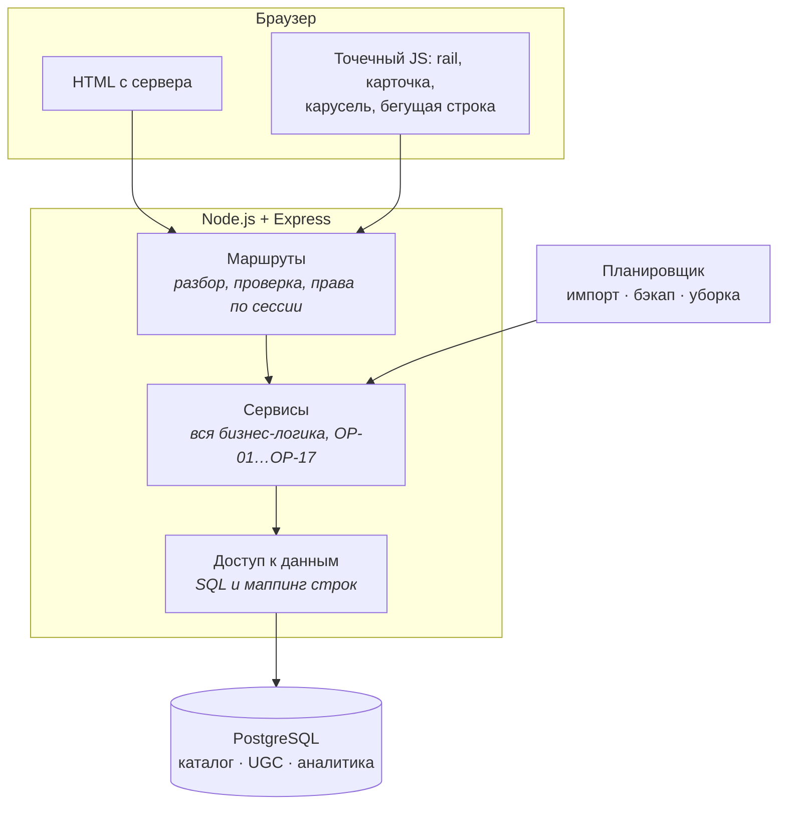

# Σ SigmaSeries — учёт просмотренных сериалов и календарь выходов

> Отмечаешь серии, ставишь оценки, подписываешься на выходы — и получаешь один ответ на вопрос «что я не досмотрел и что завтра выходит».

[](https://nodejs.org)
[](https://postgresql.org)
[](LICENSE)

## Содержание

- [Что это](#что-это)
- [Стек](#стек)
- [Архитектура](#архитектура)
- [Структура репозитория](#структура-репозитория)
- [Быстрый старт](#быстрый-старт)
- [Данные](#данные)
- [Проверки](#проверки)
- [Ограничения](#ограничения)
- [Лицензия](#лицензия)
- [Источники и благодарности](#источники-и-благодарности)

## Что это

Сервис, где учёт просмотренного и календарь выходов серий живут в одном месте. Отметки и оценки говорят о прошлом, календарь — о будущем, подборки — о том, что ещё не смотрел. Ничего не стримится и ничего не хранится в файловой системе: это каталог, учёт и обсуждения.

**Роли.** Гость смотрит каталог и читает опубликованные материалы. Зритель отмечает серии, ведёт статусы, ставит оценки, пишет отзывы и обсуждения, подписывается на выходы. Редактор модерирует материалы. Аналитик читает агрегаты. Администратор ведёт каталог и пользователей. Полная матрица прав — 5 ролей × 24 объекта без пустых клеток — в [`docs/01-product/ROLES-PERMISSIONS.md`](docs/01-product/ROLES-PERMISSIONS.md).

**Каталог.** Сериалы, сезоны и серии; постеры, фоны и описания; рейтинги IMDb, TMDB и сайта; даты выхода. Данные приходят из IMDb и TMDB, чего нет — закрывается заглушкой и дописывается в контент-студии.

**Что отличает сервис от аналогов:**

- Календарь выхода — основной сценарий, а не дополнительный раздел: страница сериала отвечает на вопрос «что дальше».
- Спойлеры в отзывах помечаются автором; отзывы группируются по длине и оценке, средние показываются только в общей группе — так видно полярность, а не усреднённую оценку.
- Модерация без машинного обучения: нормализация текста и поиск по двуязычному словарю, результат скрыт до решения редактора. Автор не знает, какое именно слово сработало, — иначе обход сводится к замене на синоним.
- Персональные итоги по точным отметкам просмотра. Ретро-отметки в них не участвуют: человек, нажавший «отметить всё до этой» дважды, не должен получать правдоподобное «любимое время суток».
- Светлая и тёмная темы, русский и английский интерфейсы, переключатель языка обязателен.

## Стек

| Слой | Выбор | Почему |
|---|---|---|
| Время выполнения | Node.js ≥ 22 | встроенный `node:test` покрывает тесты без зависимостей |
| Сервер | Express 5 | обработка ошибок промисов из коробки |
| Язык | JavaScript, ES Modules | типизация — JSDoc с проверкой `tsc --checkJs` |
| База данных | PostgreSQL 16+ | русский полнотекстовый поиск по телу материалов без внешнего сервиса; ссылочная целостность встроена |
| Представление | серверный рендеринг шаблонов | около 40 экранов индексируются; контент в первом байте ответа |
| Планировщик | `node-cron` внутри процесса | задач пять, внешний планировщик не нужен |
| Стили | одна таблица, собирается из частей на этапе сборки | пользователю отдаётся один файл |

Полный список зависимостей с обоснованием каждой и с перечнем осознанных отказов — в [`docs/05-architecture/STACK.md`](docs/05-architecture/STACK.md). Решения, которые за этим стоят, оформлены отдельными файлами в [`docs/05-architecture/adr/`](docs/05-architecture/adr/).

## Архитектура



Правило, из которого следует всё остальное: **маршрут не содержит логики, сервис не знает про HTTP, слой данных ни о ком не знает.** Проверяется просто — тест на сервис пишется без `req`.

Подробно, с обоснованием каждого решения и с его ценой — в [`docs/05-architecture/ARCHITECTURE.md`](docs/05-architecture/ARCHITECTURE.md).

## Структура репозитория

```
.
├── src/
│   ├── server.js         запуск процесса
│   ├── app.js            сборка приложения Express
│   ├── routes/           маршруты: разбор, проверка, вызов сервиса
│   ├── view/             шаблоны; всё подставляемое экранируется
│   ├── i18n/             каталог сообщений ru/en
│   ├── styles/           части таблицы стилей
│   └── services/          бизнес-логика, без HTTP и без знания о базе
│   ├── moderation/        проверка материала (OP-01)
│   ├── import/            сопоставление каталогов, полнота карточки (OP-06, OP-07)
│   ├── backup/            резервная копия с проверкой восстановления (OP-17)
│   ├── auth/              пароли, токены, сравнение
│   └── audit/             журнал действий и очистка секретов
├── tests/                 node:test, без зависимостей
├── db/schema.sql          ← генерируется из docs/04-data/DATABASE.md
├── docs/
│   ├── STATUS.md          ← генерируется: где мы, что открыто, цифры
│   ├── 00-process/        план, решения, реестры, трассируемость
│   ├── 01-product/        модули, экраны, пути, состояния, права, глоссарий
│   │   └── features/      глубокие спеки модулей M0…M12
│   ├── 02-design/         принципы, токены, сетка, материалы, движение, сцены
│   ├── 03-standards/      безопасность, угрозы, SEO, скорость, i18n, a11y,
│   │                      аналитика, модерация, тестирование
│   ├── 04-data/           модель данных, схема, источники, сроки хранения
│   ├── 05-architecture/   архитектура, стек, adr/
│   ├── 06-agents/         карта чтения и протоколы для агента
│   └── 07-kp/             соответствие заданию и переписка
├── tools/
│   ├── docs-build/        генерация реестров, пакеты контекста
│   └── schema/            извлечение DDL из документации
├── .opencode/             команды и субагент для работы над проектом
└── input/                 исходные материалы
```

`docs/_packs/` — сгенерированные пакеты контекста, в репозиторий не попадают. Каталоги, начинающиеся с подчёркивания, участвуют только как результат генерации, а не как источник: иначе пересборка реестров примет их за документацию.

## Быстрый старт

Нужны **Node.js ≥ 22**, **PostgreSQL ≥ 16**, Python 3.9+ для инструментов документации.

```bash
npm install
createdb serial_tracker
psql -d serial_tracker -v ON_ERROR_STOP=1 -f db/schema.sql
npm test
```

Тесты, требующие живой базы, читают стандартные переменные PostgreSQL — те же, что у `psql`:

```bash
PGHOST=/var/run/postgresql PGUSER=имя PGDATABASE=serial_tracker npm test
```

Без этих переменных проверки схемы пропускаются, а не падают: пропуск виден в выводе. Подключаться нужно ролью, **не являющейся владельцем схемы**: приложение работает под `st_app`, которую создаёт `db/schema.sql`, и только она лишена права писать в журнал аудита и удалять оценки.

### Конфигурация

| Переменная | Назначение |
|---|---|
| `PGHOST`, `PGPORT`, `PGUSER`, `PGDATABASE` | подключение к базе |
| `TEST_DATABASE_URL` | альтернатива им: полная строка подключения для тестов |
| `TMDB_API_KEY` | ключ TMDB для загрузки каталога |
| `DATABASE_URL` | подключение приложения |

### Запуск приложения

```bash
PGHOST=localhost PGUSER=имя PGDATABASE=serial_tracker npm start
```

Сервер поднимется на `http://127.0.0.1:3000/ru/`. Приложение должно
подключаться ролью **не владельца схемы** — иначе права на уровне БД не
действуют (см. ниже).

Открытые адреса: `/` — переход на русский, `/{ru|en}/` — главная,
`/{ru|en}/login` — вход, `/{ru|en}/register` — регистрация,
`/{ru|en}/register/confirm` — «проверьте почту»,
`/{ru|en}/verify?token=…` — подтверждение адреса, `/robots.txt`, `/app.css`.
Выход — только `POST /{ru|en}/logout`: кнопки для него в интерфейсе ещё нет.
Остальные разделы не подключены: им отвечает страница «не найдено».

Почтового шлюза ещё нет. Письмо подтверждения **печатается в консоль**
сервера — оттуда берётся ссылка, которой подтверждается адрес. Это
временная замена до фичи F-01-12, а не режим отладки: шлюз подключается как
зависимость, и подменить его на настоящий — одна строка в `src/server.js`.

Перед запуском нужен секрет сессий:

```bash
export SESSION_SECRET=$(openssl rand -hex 32)
```

Без него сервер не стартует: сессии подписываются им, а неподписанный
идентификатор можно подделать.

## Данные

| Источник | Что берём | Покрытие |
|---|---|---|
| Датасеты IMDb (`datasets.imdbws.com`) | рейтинг, число голосов, год, жанры, люди, даты серий | 101 857 сериалов с оценками |
| TMDB API | постеры, фоны, описания ru/en, даты выходов, статус, возрастная метка | 1197 из 1197 позиций каталога |
| TVmaze | — | отклонён: 0 из 60 «ждущих сезон» имели дату следующей серии (DEC-019) |

Датасеты IMDb предназначены для некоммерческого использования и в репозитории не хранятся. TMDB требует пометки источника и соблюдения условий использования.

Каталог — 1197 позиций: топ-1000 по голосам IMDb плюс сериалы с эпизодами до конца 2026 года. Сопоставление IMDb → TMDB даёт 994 из 1000; оставшиеся шесть расходятся по году и уходят в ручную правку — ложное совпадение хуже пропуска, потому что склеивает два разных сериала и разносит по карточке чужие отзывы.

Подробности источников, методика замера и решения по покрытию — в [`docs/04-data/DATA-SOURCES.md`](docs/04-data/DATA-SOURCES.md) и [`docs/04-data/CONTENT-PLAN.md`](docs/04-data/CONTENT-PLAN.md).

## Проверки

Четыре независимые проверки. Первые две проверяют код, последние две — документацию.

```bash
npm start             # сервер на :3000
npm test              # node:test, 0 зависимостей
npm run db:check      # db/schema.sql соответствует DATABASE.md
npm run docs          # пересборка реестров и STATUS + проверка ссылок
npm run css:check     # public/app.css соответствует src/styles
npm run docs:check    # размеры пакетов контекста, битые ссылки, повторы
```

`npm run verify` выполняет все пять и используется перед отправкой изменений.

**Тесты** берут настройки подключения из переменных `PG*`. Проверки, требующие инспекции каталога базы, выполняются только под владельцем схемы: PostgreSQL фильтрует `information_schema` по привилегиям, и под ролью приложения ограничения таблицы журнала не видны, хотя они есть.

**Реестры.** [`build_registries.py`](tools/docs-build/build_registries.py) создаёт [`FEATURES.md`](docs/01-product/FEATURES.md), [`COVERAGE.md`](docs/00-process/COVERAGE.md), [`EDGE-CASES.md`](docs/00-process/EDGE-CASES.md) и [`STATUS.md`](docs/STATUS.md), затем проверяет, что у каждого упомянутого `EC-`, `H-` и `R-` есть определение. Код 0 — расхождений нет; код 1 — расхождения найдены, и это ожидаемый режим, не авария. Эти четыре файла **править руками нельзя**.

**Схема.** `db/schema.sql` генерируется из `docs/04-data/DATABASE.md`: документ остаётся источником истины и одновременно приложением к документации, а исполняемый файл не расходится с ним. `npm run db:check` падает при расхождении.

> Проверка ссылок подтверждает, что правило **существует**, а не что оно **то самое**. Номер, который резолвится, может означать не то, чем кажется: `R-SEC-04` проходит любую автоматическую проверку, хотя это про 2FA, а не про запрет ссылок. Правила из пакета нужно читать. Разбор — в [`docs/06-agents/PROTOCOLS.md`](docs/06-agents/PROTOCOLS.md).

## Ограничения

- **Отдаются четыре экрана.** Главная, вход, регистрация и подтверждение адреса. Остальные экраны реестра не подключены: маршруты и шаблоны для них ещё не написаны.
- **Почтового шлюза нет.** Письмо подтверждения печатается в консоль сервера (F-01-12). Настоящая отправка не проверялась ни разу.
- **Шаг 3 регистрации не построен.** После подтверждения человек идёт на главную, минуя выбор любимых сериалов. Полный список отложенного — в [`IMPROVEMENTS.md`](IMPROVEMENTS.md).
- **Ревью спецификации не пройдено.** Матрица покрытия считает наличие раздела, а не содержание, поэтому полное заполнение в ней не означает проработанности.
- **Правила безопасности реализованы не полностью.** Работают хеширование паролей, слепой индекс адреса, одноразовые токены (в базе только хеш), сессии на сервере, CSRF, `no-store` на личных страницах, лимиты входа с нарастающей задержкой, невидимая проверка вместо CAPTCHA на входе и на регистрации, лимиты повторных писем, права на уровне БД, очистка секретов из журнала и экранирование разметки. Не сделаны: двухфакторная проверка, отзыв сессий при смене пароля и роли, список устройств, лимит по IP на входе, очередь тяжёлого хеширования.
- **Счётчики перебора живут в памяти процесса.** При перезапуске они обнуляются, и человек получает ещё несколько попыток. Это защита от случайного перебора, а не от распределённой атаки.
- **Проверка каталога требует прав владельца БД** — приложение под ними работать не может.

## Лицензия

[MIT](LICENSE) — можно использовать, изменять и распространять при сохранении
уведомления об авторском праве.

## Источники и благодарности

- Данные — [IMDb Datasets](https://datasets.imdbws.com/) и [TMDB](https://www.themoviedb.org/).
- Дизайн-направления — 21 TSI и OpenSea; они расходятся между собой, и вместо усреднения каждое закреплено за своей сценой в [`docs/02-design/SCENES.md`](docs/02-design/SCENES.md).
- Правила интерфейса выведены из авторского чек-листа и закреплены как 43 проверяемых утверждения в [`docs/02-design/PRINCIPLES.md`](docs/02-design/PRINCIPLES.md).
- Структура этого файла — [The Ultimate README Guide](input/The%20Ultimate%20README%20Guide.md).

История изменений — в Git:

```bash
git log --oneline
```