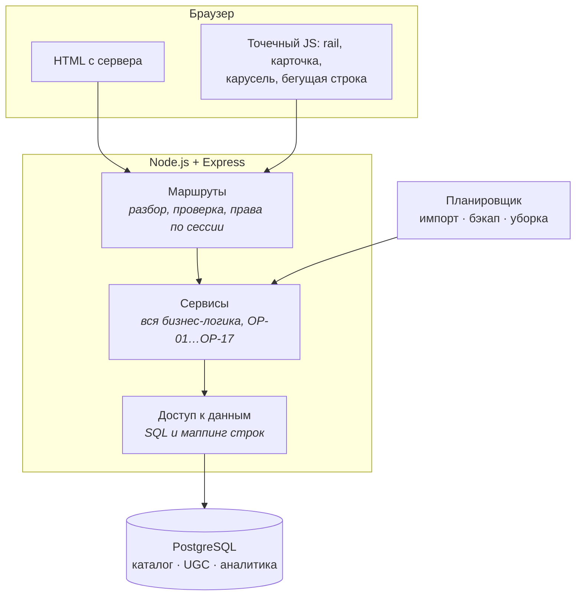

# Σ SigmaSeries — учёт просмотренных сериалов и календарь выходов

> Отмечаешь серии, ставишь оценки, подписываешься на выходы — и получаешь один ответ на вопрос «что я не досмотрел и что завтра выходит».

[](https://nodejs.org)
[](https://postgresql.org)
[](LICENSE)

## Содержание

- [Что это](#что-это)
- [Стек](#стек)
- [Архитектура](#архитектура)
- [Структура репозитория](#структура-репозитория)
- [Быстрый старт](#быстрый-старт)
- [Данные](#данные)
- [Проверки](#проверки)
- [Ограничения](#ограничения)
- [Лицензия](#лицензия)
- [Источники и благодарности](#источники-и-благодарности)

## Что это

Сервис, где учёт просмотренного и календарь выходов серий живут в одном месте. Отметки и оценки говорят о прошлом, календарь — о будущем, подборки — о том, что ещё не смотрел. Ничего не стримится и ничего не хранится в файловой системе: это каталог, учёт и обсуждения.

**Роли.** Гость смотрит каталог и читает опубликованные материалы. Зритель отмечает серии, ведёт статусы, ставит оценки, пишет отзывы и обсуждения, подписывается на выходы. Редактор модерирует материалы. Аналитик читает агрегаты. Администратор ведёт каталог и пользователей. Полная матрица прав — 5 ролей × 24 объекта без пустых клеток — в [`docs/01-product/ROLES-PERMISSIONS.md`](docs/01-product/ROLES-PERMISSIONS.md).

**Каталог.** Сериалы, сезоны и серии; постеры, фоны и описания; рейтинги IMDb, TMDB и сайта; даты выхода. Данные приходят из IMDb и TMDB, чего нет — закрывается заглушкой и дописывается в контент-студии.

**Что отличает сервис от аналогов:**

- Календарь выхода — основной сценарий, а не дополнительный раздел: страница сериала отвечает на вопрос «что дальше».
- Спойлеры в отзывах помечаются автором; отзывы группируются по длине и оценке, средние показываются только в общей группе — так видно полярность, а не усреднённую оценку.
- Модерация без машинного обучения: нормализация текста и поиск по двуязычному словарю, результат скрыт до решения редактора. Автор не знает, какое именно слово сработало, — иначе обход сводится к замене на синоним.
- Персональные итоги по точным отметкам просмотра. Ретро-отметки в них не участвуют: человек, нажавший «отметить всё до этой» дважды, не должен получать правдоподобное «любимое время суток».
- Светлая и тёмная темы, русский и английский интерфейсы, переключатель языка обязателен.

## Стек

| Слой | Выбор | Почему |
|---|---|---|
| Время выполнения | Node.js ≥ 22 | встроенный `node:test` покрывает тесты без зависимостей |
| Сервер | Express 5 | обработка ошибок промисов из коробки |
| Язык | JavaScript, ES Modules | типизация — JSDoc с проверкой `tsc --checkJs` |
| База данных | PostgreSQL 16+ | русский полнотекстовый поиск по телу материалов без внешнего сервиса; ссылочная целостность встроена |
| Представление | серверный рендеринг шаблонов | около 40 экранов индексируются; контент в первом байте ответа |
| Планировщик | `node-cron` внутри процесса | задач пять, внешний планировщик не нужен |
| Стили | таблицы по экранам, собираются из частей; статика сжимается gzip | страница тянет общую таблицу и те, что ей нужны: около 20 КБ вместо 160 (DEC-067) |
| Почта | `nodemailer` | SMTP-протокол и подтверждение ящика на защите — то, что нельзя проверить глазами |

Полный список зависимостей с обоснованием каждой и с перечнем осознанных отказов — в [`docs/05-architecture/STACK.md`](docs/05-architecture/STACK.md). Решения, которые за этим стоят, оформлены отдельными файлами в [`docs/05-architecture/adr/`](docs/05-architecture/adr/).

## Архитектура



Правило, из которого следует всё остальное: **маршрут не содержит логики, сервис не знает про HTTP, слой данных ни о ком не знает.** Проверяется просто — тест на сервис пишется без `req`.

Подробно, с обоснованием каждого решения и с его ценой — в [`docs/05-architecture/ARCHITECTURE.md`](docs/05-architecture/ARCHITECTURE.md).

## Структура репозитория

```
.
├── src/
│   ├── server.js         запуск процесса
│   ├── app.js            сборка приложения Express
│   ├── routes/           маршруты: разбор, проверка, вызов сервиса
│   ├── view/             шаблоны; всё подставляемое экранируется
│   ├── i18n/             каталог сообщений ru/en
│   ├── styles/           части таблицы стилей
│   └── services/          бизнес-логика, без HTTP и без знания о базе
│   ├── moderation/        проверка материала (OP-01)
│   ├── import/            сопоставление каталогов, полнота карточки (OP-06, OP-07)
│   ├── backup/            резервная копия с проверкой восстановления (OP-17)
│   ├── auth/              пароли, токены, сравнение
│   └── audit/             журнал действий и очистка секретов
├── tests/                 node:test, без зависимостей
├── db/schema.sql          ← генерируется из docs/04-data/DATABASE.md
├── docs/
│   ├── STATUS.md          ← генерируется: где мы, что открыто, цифры
│   ├── 00-process/        план, решения, реестры, трассируемость
│   ├── 01-product/        модули, экраны, пути, состояния, права, глоссарий
│   │   └── features/      глубокие спеки модулей M0…M12
│   ├── 02-design/         принципы, токены, сетка, материалы, движение, сцены
│   ├── 03-standards/      безопасность, угрозы, SEO, скорость, i18n, a11y,
│   │                      аналитика, модерация, тестирование
│   ├── 04-data/           модель данных, схема, источники, сроки хранения
│   ├── 05-architecture/   архитектура, стек, adr/
│   ├── 06-agents/         карта чтения и протоколы для агента
│   └── 07-kp/             соответствие заданию и переписка
├── tools/
│   ├── docs-build/        генерация реестров, пакеты контекста
│   └── schema/            извлечение DDL из документации
├── .opencode/             команды и субагент для работы над проектом
└── input/                 исходные материалы
```

`docs/_packs/` — сгенерированные пакеты контекста, в репозиторий не попадают. Каталоги, начинающиеся с подчёркивания, участвуют только как результат генерации, а не как источник: иначе пересборка реестров примет их за документацию.

## Быстрый старт

Нужны **Node.js ≥ 22**, **PostgreSQL ≥ 16**, Python 3.9+ для инструментов документации.

```bash
npm install
createdb serial_tracker
psql -d serial_tracker -v ON_ERROR_STOP=1 -f db/schema.sql
npm test
```

Тесты, требующие живой базы, читают стандартные переменные PostgreSQL — те же, что у `psql`:

```bash
PGHOST=/var/run/postgresql PGUSER=имя PGDATABASE=serial_tracker npm test
```

Без этих переменных проверки схемы пропускаются, а не падают: пропуск виден в выводе. Подключаться нужно ролью, **не являющейся владельцем схемы**: приложение работает под `st_app`, которую создаёт `db/schema.sql`, и только она лишена права писать в журнал аудита и удалять оценки.

### Конфигурация

| Переменная | Назначение |
|---|---|
| `PGHOST`, `PGPORT`, `PGUSER`, `PGDATABASE` | подключение к базе |
| `TEST_DATABASE_URL` | альтернатива им: полная строка подключения для тестов |
| `TMDB_API_KEY` | ключ TMDB для загрузки каталога |
| `DATABASE_URL` | подключение приложения |
| `MAIL_MODE` | режим почты: `smtp` (по умолчанию) или `devbox`. Значение администратора в `e_system_setting` перекрывает переменную (DEC-035) |
| `SMTP_HOST`, `SMTP_PORT`, `SMTP_SECURE` | провайдер отправки; без `SMTP_HOST` письма не уходят и повторяются |
| `SMTP_USER`, `SMTP_PASS`, `MAIL_FROM` | учётные данные провайдера и адрес отправителя. В базе им не место (F-01-12 §4) |
| `MAIL_PRINT` | `true` — печатать письма в консоль при неудачной доставке |

### Запуск приложения

```bash
PGHOST=localhost PGUSER=имя PGDATABASE=serial_tracker npm start
```

Сервер поднимется на `http://127.0.0.1:3000/ru/`. Приложение должно
подключаться ролью **не владельца схемы** — иначе права на уровне БД не
действуют (см. ниже).

Открытые адреса: `/` — переход на русский, `/{ru|en}/` — главная,
`/{ru|en}/series/{slug}` — карточка сериала,
`/{ru|en}/login` — вход, `/{ru|en}/register` — регистрация,
`/{ru|en}/register/confirm` — «проверьте почту»,
`/{ru|en}/verify?token=…` — подтверждение адреса, `/{ru|en}/2fa` — второй
фактор, `/{ru|en}/password/reset?token=…` — восстановление пароля,
`/{ru|en}/settings` — настройки (профиль, вид, уведомления, приватность,
безопасность, данные), `/{ru|en}/delete-pending` — вход в период удаления,
`/{ru|en}/admin/mailbox` — почтовый ящик администратора, `/robots.txt`,
`/app.css`. Выход — только `POST /{ru|en}/logout`. Всё, чего нет в этом
списке, отвечает страницей «не найдено»; служебные страницы отвечают 404 и
не-админу тоже.

### Почта и защита без интернета

Два режима, переключается переменной `MAIL_MODE` и страницей S-84:

- **`smtp`** — отправка через провайдера (`nodemailer`, параметры только из
  окружения). Без `SMTP_HOST` письма остаются в очереди и повторяются: не
  настроенный провайдер — это не повод терять письма.
- **`devbox`** — письмо **не уходит вовсе**, остаётся в базе и показывается в
  S-84. На шаге 2 регистрации и на странице сброса появляется «Демо-режим:
  открыть письмо»: подсказка показывает только письмо, созданное этим же
  браузером (H-51).

Режим `devbox` — то, ради чего затевался F-01-12: **на защите интернета нет**,
и без него показать подтверждение адреса было бы нечем. Проверить сценарий
можно так:

```bash
export MAIL_MODE=devbox MAIL_PRINT=true
PGHOST=localhost PGUSER=имя PGDATABASE=serial_tracker npm start
```

Зарегистрируйтесь, на странице «проверьте почту» нажмите «Демо-режим:
открыть письмо» и подтвердите адрес. Никакого внешнего сервиса не требуется.

**Первый администратор.** Управления ролями в проекте нет — это S-72 (M9).
Поэтому S-84 и переключатель режима сейчас недостижимы: роль выдаётся вручную.

```sql
INSERT INTO e_role_assignment (user_id, role) VALUES (<id>, 'admin');
```

Отзыв — `DELETE FROM e_role_assignment WHERE role = 'admin'`.

Перед запуском нужны три секрета, и они не взаимозаменяемы: `R-SEC-26`
требует раздельные ключи для сессий, шифрования и HMAC, потому что ротация
одного не должна ломать остальные.

```bash
export SESSION_SECRET=$(openssl rand -hex 32)      # подпись сессий
export BLIND_INDEX_SECRET=$(openssl rand -hex 32)  # HMAC для поиска по адресу
export ADDRESS_SECRET=$(openssl rand -hex 32)      # шифротекст адреса (AES-256-GCM)
export MAIL_SECRET=$(openssl rand -hex 32)         # шифротекст писем: отдельный ключ, утечка одного не раскрывает другой
```

Для локального запуска эти четыре секрета удобнее положить в **`.env`** в корне
репозитория — файл уже в `.gitignore`, а `npm start` и скрипт импорта читают
его сами (`--env-file-if-exists=.env`). Состав переменных с комментариями —
[`.env.example`](.env.example); туда же кладутся параметры базы, почты и
`TMDB_TOKEN`. Тесты `.env` не читают: настройки подключения они берут из
`PG*`, а секреты для проверок ставит `tests/setup.js` — иначе «зелёный»
прогон зависел бы от файла, которого у другого человека нет. На настоящем
развёртывании секреты приходят из окружения службы, а не из файла рядом с
кодом.

Без любого из них соответствующая операция падает с внятной ошибкой, а не
работает «как-то»: без `SESSION_SECRET` не подписывается сессия, без
`BLIND_INDEX_SECRET` аккаунт не находится по адресу, без `ADDRESS_SECRET`
адрес не шифруется, без `MAIL_SECRET` не шифруются письма.

> Уже заведённые аккаунты хранят в `e_user.email_enc` пустое значение:
> восстановить из него адрес нельзя, потому что открытым он не сохранялся.
> Для разработки это не мешает — аккаунты заводятся заново. Перевод боевой
> базы на шифрование требует одноразового прохода по старым адресам.

## Данные

| Источник | Что берём | Покрытие |
|---|---|---|
| Датасеты IMDb (`datasets.imdbws.com`) | рейтинг, число голосов, год, жанры, люди, даты серий | 101 857 сериалов с оценками |
| TMDB API | постеры, фоны, описания ru/en, даты выходов, статус, возрастная метка | 1197 из 1197 позиций каталога |
| TVmaze | — | отклонён: 0 из 60 «ждущих сезон» имели дату следующей серии (DEC-019) |

### Импорт каталога

```bash
npm run import:candidates
```

Скрипт скачивает датасеты IMDb в `data/imdb/` (226 МБ, файла в репозитории
нет — лицензия только на личное некоммерческое использование), отбирает
`import.top_n` самых популярных сериалов и записывает результат прогона в
`e_import_item_result`. Ключ TMDB на этом шаге не нужен: он понадобится
сопоставлению (F-12-02).

Файлы старше семи дней считаются несвежими и качаются заново; превышение
512 МБ или пятнадцати минут обрывает попытку, после трёх попыток прогон
завершается ошибкой, а каталог остаётся прежним (DEC-038). Каталог сам по
себе скрипт **не меняет** — запись сериалов в базу это F-12-06.

Сопоставление с TMDB — отдельный шаг, ему нужен `TMDB_TOKEN`:

```bash
npm run import:match              # все кандидаты последнего отбора
npm run import:match -- --limit 50
```

Замер на живом API 14.10: 1000 позиций за 107 с, **987 подтверждено**, 10 не
найдено (`no_tmdb`), 3 сомнительных (`pair_doubt` — их вручную подтверждает
админ в S-74). Пара подтверждается обратным идентификатором IMDb и годом ±1,
название не сверяется (H-28): две разные локализации одного сериала дали бы
ложное расхождение.

Обогащение — третий шаг, за карточкой и сезонами:

```bash
npm run import:enrich              # все подтверждённые пары
npm run import:enrich -- --limit 20
```

Скачиваются датасеты людей (`title.crew` 80 МБ, `title.principals` 750 МБ,
`name.basics` 297 МБ), затем один проход собирает режиссёров и «В ролях» для
всего каталога, потом обход TMDB: карточка на `ru-RU` и `en-US` плюс по
одному запросу на каждый сезон. Сырой слой складывается в
`e_import_item_result.raw`; в каталог его записывает F-12-06.

Запись в каталог — последний шаг цепочки:

```bash
npm run import:catalogue           # все обогащённые сериалы
npm run import:catalogue -- --limit 20
```

Каждый сериал пишется в своей транзакции: сбой одного не уносит остальных.
Считаются состояние выхода (сначала даты, потом статус TMDB — H-39), полнота
и коды причин, адрес по H-32, сезоны с сериями и выходы; серии одной даты
склеиваются в один выход (EC-D11). Поля, заблокированные в `e_field_lock`,
импорт не трогает (EC-D8), а архивный сериал обновляется, но остаётся
архивным.

Загрузка картинок — пятый шаг:

```bash
npm run import:images             # постеры и фоны для всех сериалов
npm run import:images -- --limit 20
```

Файлы берутся только с `image.tmdb.org` (R-SEC-18), тип определяется по
содержимому, а не по имени (R-SEC-17), и перекодируются без метаданных.
Фон для баннера и заставки берётся без текста, шириной от 1920 и пропорцией
16:9; сериал, у которого такого нет, годится только для обычного фона под
шапкой. Варианты по ширинам 185/342/500 и 780/1280/1920 лежат в
`e_image_variant`, бюджет базы — 2 ГБ (§7).

Весь путь от пустой базы до каталога — пять команд:

```bash
npm run import:candidates
npm run import:match
npm run import:enrich
npm run import:images
npm run import:catalogue
```

Ночью то же делает приложение само: планировщик внутри процесса (`node-cron`,
ADR-004) в `import.schedule_time` обновляет расписание активных сериалов, сразу
за ним открывает новые, а раз в неделю — в понедельник — обновляет рейтинги
IMDb из датасета. Отдельно те же задачи запускаются руками:

```bash
npm run import:schedule                 # расписание у всех активных сериалов
npm run import:schedule -- --limit 50
npm run import:schedule -- --tconst tt1234567   # один сериал
npm run import:schedule -- --dry-run    # показать, что изменилось бы
```

Ночной прогон не трогает то, чего не проверял: людей он не качает (они из
IMDb), поэтому причина `no_people` переносится из прошлой карточки, а полнота
не падает. Пропущенная ночь — не отсутствие запуска, а строка со статусом
`skipped`; если сервер выключили на сутки и больше, при старте расписание
догоняется, а при простое дольше 36 часов в журнал пишется «данные устарели».

Датасеты IMDb предназначены для некоммерческого использования и в репозитории не хранятся. TMDB требует пометки источника и соблюдения условий использования.

За день до защиты каталог замораживается: снимается копия и **проверяется
восстановлением** во временную базу, выключается импорт и, по желанию, почта
переводится в `devbox`. После этого ни один шаг импорта не запустится, а
главная, каталог, карточки и картинки продолжают открываться.

```bash
npm run import:freeze              # копия с проверкой, импорт выключен
npm run import:freeze -- status    # что сейчас
npm run import:freeze -- --unfreeze  # вернуть как было (EC-I13)
```

Проверенный дамп остаётся в `backups/` и записывается в `e_backup_job` —
вместе с путём, размером и временем проверки: копия, о которой нигде не
записано, на защите неотличима от её отсутствия. Ротация по `backup.keep_last`
удаляет только проверенные копии сверх срока, негодную не трогает.

Копия снимается не только руками: сервер раз в четверть часа смотрит на
`backup.schedule` (по умолчанию 03:30 местного времени) и, если за сегодня
копии ещё не было, снимает её тем же кодом с той же записью в журнал.
Пропущенный день догоняется при ближайшем запуске — поздняя копия лучше
отсутствующей.

На защите показывают отдельную базу: рабочая — общая с прогонами тестов, и
к этому моменту в ней тысячи тестовых аккаунтов. Копия снимается, мусор
вычищается, остаются каталог и два аккаунта для показа:

```bash
npm run demo:db                 # собрать из последней копии (или снять новую)
npm run demo:db -- --force      # пересоздать, если база уже есть
PGDATABASE=serial_tracker_demo npm start
```

Пользователи очищаются через `TRUNCATE`: в базе стоит правило `no_delete_user`
(R-SQL-02 — персональные данные не удаляются молча), и `DELETE FROM e_user`
возвращает `DELETE 0`, не удаляя ничего.

Адреса аккаунтов хранятся слепым индексом (HMAC от `BLIND_INDEX_SECRET`),
поэтому `demo:db` нужно запускать с тем же секретом, что и сервер: собранные
при этом учётные записи иначе не находятся по адресу, и вход вернёт 401 без
объяснения. Проще всего запускать и то и другое из одного `.env`.

Служебные роли выдаются командой — экраны служебных разделов строятся, а роли
выдать было нечем:

```bash
npm run role -- list user@example.com
npm run role -- grant admin user@example.com --reason "защита, DEC-020"
npm run role -- grant analyst user@example.com --days 7 --reason "аналитика за декабрь"
npm run role -- revoke analyst user@example.com --reason "срок вышел"
```

Причина обязательна: она попадает в журнал аудита (`e_audit_log`), и вход в
служебный раздел требует второго фактора.

Заморозка откажется сама, если идёт импорт или копия не восстановилась: копия,
которая только записалась, копией не считается (OP-17). На S-76 состояние режима
видно («Режим: защита»), а включается и выключается он из командной строки:
включение и разморозка в студии не построены. Полный прогон снимка на базе
в 452 МБ занимает около 20 секунд.

Каталог — 1197 позиций: топ-1000 по голосам IMDb плюс сериалы с эпизодами до конца 2026 года. Сопоставление IMDb → TMDB даёт 994 из 1000; оставшиеся шесть расходятся по году и уходят в ручную правку — ложное совпадение хуже пропуска, потому что склеивает два разных сериала и разносит по карточке чужие отзывы.

Каталог и поиск открыты гостю: `/series` — фильтры по жанрам, годам, рейтингу
IMDb, состоянию выхода, стране и каналу или платформе, сортировка и
постраничность; `/series/{slug}/seasons/{n}` и `…/episodes/{m}` — сезон и серия
с датами выхода и соседями; `/search` — сериалы, люди и подборки; `/people/{slug}`
и `/collections/{slug}` — страница человека и подборка; `/calendar` — выходы
серий месяцем, неделей или списком, с фильтром «Все / Мои»; `/library` —
закладки вошедшего со статусами, сортировкой и поиском по списку. Статус
сериала меняется кнопкой на его странице и двигает подписку на выходы, поэтому
«Мои» в календаре наполняется сам. Колокольчик рядом со статусом включает и
выключает уведомления о выходах: он помнит ручное решение (выключенное вручную
«Смотрю» обратно не включает) и говорит, кто решил — человек или автоматика,
а у гостя на его месте приглашение войти. Сезон и серия отмечаются одним флажком;
массовые отметки отменяются в течение десяти секунд, а на странице сериала и в
закладках видно «сколько отмечено из вышедших» и что смотреть дальше. Ежечасная
задача создаёт уведомления о выходах по подпискам — по часовому поясу
подписчика, пачками по 500 и без дублей при повторе, — и заодно обновляет кэш
прогресса, когда вышла новая серия. Экрана уведомлений пока нет: он и есть
F-03-09, записи уже копятся в базе. Снятый с
публикации сериал не открывается ни карточкой, ни сезоном, ни серией. Фильтры
и постраничность живут в адресе, поэтому ссылкой можно поделиться, а страница
работает и без скриптов. Поиск приводит регистр, `ё`, пунктуацию и основу слова: запрос идёт
по полнотекстовому индексу PostgreSQL, поэтому «человеком» находит «Человек в
высоком замке», а слова без точной формы («тяжких») ловятся совпадением как
есть; если запрос не нашёл ничего, но нашёлся в другой раскладке — появляется
пометка «возможно, имелось в виду». Подсказки в верхней панели — улучшение, а не
условие работы.

Подробности источников, методика замера и решения по покрытию — в [`docs/04-data/DATA-SOURCES.md`](docs/04-data/DATA-SOURCES.md) и [`docs/04-data/CONTENT-PLAN.md`](docs/04-data/CONTENT-PLAN.md).

## Проверки

Четыре независимые проверки. Первые две проверяют код, последние две — документацию.

```bash
npm start             # сервер на :3000
npm test              # node:test, 0 зависимостей
npm run db:check      # db/schema.sql соответствует DATABASE.md
npm run docs          # пересборка реестров и STATUS + проверка ссылок
npm run css:check     # public/app.css соответствует src/styles
npm run docs:check    # размеры пакетов контекста, битые ссылки, повторы
```

`npm run verify` выполняет все пять и используется перед отправкой изменений.

**Проверять надо на настоящей базе.** Тесты HTTP идут по заглушке
`stubAuthStore`, и она дважды разошлась с `pgAuthStore` так, что код падал
с 500 только в бою. Поэтому:

- после правки `src/services/auth/store.js` обязателен `npm test` с
  переменными `PG*` — `tests/auth.store.test.js` выполняет тот же SQL против
  базы, а `tests/auth.parity.test.js` ловит расхождение интерфейсов;
- после правки `src/styles/*` обязателен `npm run css`, иначе `css:check`
  падает: пользователю отдаётся собранный `public/app.css`;
- после правки `docs/04-data/DATABASE.md` обязателен `npm run db:check`;
- после правки документации обязателен `npm run docs` — иначе реестры и
  `STATUS.md` останутся от прошлого прогона.

**Тесты** берут настройки подключения из переменных `PG*`. Проверки, требующие инспекции каталога базы, выполняются только под владельцем схемы: PostgreSQL фильтрует `information_schema` по привилегиям, и под ролью приложения ограничения таблицы журнала не видны, хотя они есть.

**Реестры.** [`build_registries.py`](tools/docs-build/build_registries.py) создаёт [`FEATURES.md`](docs/01-product/FEATURES.md), [`COVERAGE.md`](docs/00-process/COVERAGE.md), [`EDGE-CASES.md`](docs/00-process/EDGE-CASES.md) и [`STATUS.md`](docs/STATUS.md), затем проверяет, что у каждого упомянутого `EC-`, `H-` и `R-` есть определение. Код 0 — расхождений нет; код 1 — расхождения найдены, и это ожидаемый режим, не авария. Эти четыре файла **править руками нельзя**.

**Схема.** `db/schema.sql` генерируется из `docs/04-data/DATABASE.md`: документ остаётся источником истины и одновременно приложением к документации, а исполняемый файл не расходится с ним. `npm run db:check` падает при расхождении.

> Проверка ссылок подтверждает, что правило **существует**, а не что оно **то самое**. Номер, который резолвится, может означать не то, чем кажется: `R-SEC-04` проходит любую автоматическую проверку, хотя это про 2FA, а не про запрет ссылок. Правила из пакета нужно читать. Разбор — в [`docs/06-agents/PROTOCOLS.md`](docs/06-agents/PROTOCOLS.md).

## Ограничения

- **Карточка сериала сделана в первом приближении.** Открывается по
  `/{lang}/series/{slug}`, показывает шапку с рейтингами и состоянием выхода,
  описание, сезоны с сериями и датами, список людей, отдаёт 404 на неизвестный
  адрес, 410 на снятый с публикации и разметку schema.org. Сделаны кнопки
  статуса (M3), подписка на выходы, панель «Предстоящие», оценка сериала с
  гистограммой (F-04-01), страницы сезона и серии (S-07, S-08) с отметками.
  Отзывы, обсуждения и руководства (M5) и «похожие» (F-02-08) сделаны.
- **M2, M3, M4 и M5 закрыты по своим фичам.** M2 — каталог, жанры, подборки,
  поиск, слой постера и «Похожие». M3 — отметки, статусы, подписки, закладки,
  календарь, уведомления, панель «Предстоящие», настройки уведомлений. M4 —
  оценки сериала и серии, отзывы, группы, голоса «полезно», жалобы. M5 — все
  четыре вида материалов, проверка текста, очередь редактора с кластерами и
  разделением, бюджеты и авто-мьют. База наполнена: 1052 сериала, 4566
  сезонов, 101 332 серий, 87 916 выходов, 12 170 человек и 1973 картинки.
- **Картинки есть, но баннеров и заставок нет.** Загружено 987 постеров и
  986 фонов (452 МБ при бюджете 2 ГБ). Фонов без текста, пригодных для
  баннера, у TMDB практически нет: в `images.backdrops` лежат переводы с
  выжженными надписями, а чистый фон лежит в `backdrop_path` и годится только
  для шапки (H-34). Уровень карточки пересчитан: 964 «полные», 23 «пригодны к
  показу», 32 «минимум».
- **Модуль M1 закрыт по экранам, кроме публичного профиля.** Главная, вход, регистрация (все три шага, включая выбор любимых), подтверждение адреса, восстановление пароля, двухфакторная проверка, настройки (все шесть разделов, включая «Данные» — удаление и экспорт), ожидание удаления и почтовый ящик администратора. Не сделан публичный профиль `/u/{nick}` (S-18, P1).
- **Настоящая отправка писем не проверялась ни разу.** Режим `smtp` написан по документации `nodemailer` и проверен только тем, что не настроенный провайдер оставляет письмо в очереди. Режим `devbox` проверен на живом сценарии целиком.
- **Импорт сделан полностью.** F-12-01…F-12-10 — путь от датасетов IMDb до
  картинок в базе, ежедневный обзор новинок, расписание запусков, экран
  «Импорт» с кнопками запуска, устойчивый прогон с продолжением с места и
  режим защиты. Ключ TMDB нужен для обогащения и обзора, без сети каталог не
  обновляется — на защите это решает `npm run import:freeze`.
  Ключ TMDB нужен для обогащения и обзора, без сети каталог не обновляется —
  на защите это решает `npm run import:freeze`.
- **Уведомления админу о сбое импорта уходят в ленту, а не на почту.** `F-12-09`
  требует сообщить об истёкшем ключе и о частичном прогоне — это виды
  `import_key_rejected` и `import_partial` в ленте сотрудника. Отдельного
  адреса для писем у администратора нет, поэтому почтой они не приходят.
- **Роли выдаются из карточки человека** (S-72, M9). Ни один зарегистрировавшийся человек не администратор по умолчанию: роль выдаёт администратор через карточку (F-09-07), и каждое выдаче и снятие попадает в журнал аудита.
- **Публичный профиль `/u/{nick}` не построен** (S-18, P1) — это единственный незакрытый экран M1. Список отложенного — в [`IMPROVEMENTS.md`](IMPROVEMENTS.md).
- **Ревью спецификации не пройдено.** Матрица покрытия считает наличие раздела, а не содержание, поэтому полное заполнение в ней не означает проработанности.
- **Вход служебной роли требует второго фактора.** Администратор, редактор и аналитик после пароля попадают на настройку или ввод кода (F-01-05, обязательно по DEC-015). До подтверждения кода сессия прав не получает: раньше здесь стоял отказ целиком, и служебные разделы были недостижимы вовсе — а прежняя заготовка (`pendingStaff`) не читалась никто и именно это и делала.
- **Правила безопасности реализованы не полностью.** Работают хеширование паролей, слепой индекс адреса, одноразовые токены (в базе только хеш), восстановление пароля по ссылке, **двухфакторная проверка для служебных ролей** (TOTP по RFC 6238, резервные коды, запрет повтора кода), сессии на сервере, CSRF, `no-store` на личных страницах, лимиты входа с нарастающей задержкой и **по адресу сети** (R-SEC-05, 30 попыток за 15 минут), лимиты заявок на сброс и повторных писем, невидимая проверка вместо CAPTCHA на входе и на регистрации, **список устройств с отзывом чужого входа** (в списке хеш идентификатора сессии, а не сам идентификатор, и усечённый адрес /24), **потолок числа сессий на аккаунт**, права на уровне БД, очистка секретов из журнала и экранирование разметки, **отзыв сессий при смене роли и при сбросе чужой 2FA администратором**, отключение 2FA зрителем по паролю и перевыпуск резервных кодов. Не сделаны: очередь тяжёлого хеширования (записи в [`IMPROVEMENTS.md`](IMPROVEMENTS.md)).
- **Счётчики перебора живут в памяти процесса.** При перезапуске они обнуляются, и человек получает ещё несколько попыток. Это защита от случайного перебора, а не от распределённой атаки.
- **Проверка каталога требует прав владельца БД** — приложение под ними работать не может.

## Лицензия

[MIT](LICENSE) — можно использовать, изменять и распространять при сохранении
уведомления об авторском праве.

## Источники и благодарности

- Данные — [IMDb Datasets](https://datasets.imdbws.com/) и [TMDB](https://www.themoviedb.org/).
- Дизайн-направления — 21 TSI и OpenSea; они расходятся между собой, и вместо усреднения каждое закреплено за своей сценой в [`docs/02-design/SCENES.md`](docs/02-design/SCENES.md).
- Правила интерфейса выведены из авторского чек-листа и закреплены как 43 проверяемых утверждения в [`docs/02-design/PRINCIPLES.md`](docs/02-design/PRINCIPLES.md).
- Структура этого файла — [The Ultimate README Guide](input/The%20Ultimate%20README%20Guide.md).

История изменений — в Git:

```bash
git log --oneline
```