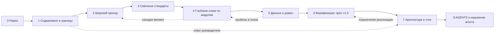

# PLAN — как довести spec до 100%

> v0.13 · 2026-10-06 · спека M4 (оценки и отзывы)
> Порядок, заданный автором: план → spec → отдельные доки (дизайн, безопасность, i18n, SEO…) → данные → **архитектура и стек в конце** → AGENTS для opencode.
> Метки в любом документе: **[РЕШЕНО]** · **[ГИПОТЕЗА]** (предположение, ждёт подтверждения) · **[ВОПРОС]**.
> Префиксы ID: `C` ограничение Бланка · `UI` компонент оболочки · `G` дыра в spec · `D` конфликт дизайн-референсов · `Q` вопрос · `M` модуль · `F` фича · `S` экран · `R` правило · `EC` edge case · `E` сущность · `EV` событие аналитики · `OP` бизнес-операция · `ADR` архитектурное решение.

> **Что изменилось в v0.2** (решения автора, см. `DECISIONS.md`): аудитория 20–35 и адаптивный дизайн; добавлены модули **M10 Контент-студия** и **M11 Рекомендации**; каталог и «выбор редакции» ведёт **админ**, редактор только модерирует; контент вносится вручную («меньше, но лучше»), внешние рейтинги — расширяемый справочник; выбор библиотек и фреймворков свободный.

> **Что изменилось в v0.3:** данные берём автоматически — **IMDb (датасеты) + TMDB (API)**, пробелы закрывает админ вручную, недостающее показываем заглушкой; каталог — **1000 самых популярных сериалов + новинки до декабря**; **защита в декабре** ⇒ добавлен календарь (§4a) и сокращённая реализация; Leonardo.ai из проекта исключён; добавлены модуль **M12 Импорт данных**, `DATA-SOURCES.md`, `PRODUCTION-READINESS.md` и разбор трёх новых материалов (`Design.md` и два чек-листа).

> **Что изменилось в v0.4:** `Q-17` закрыт (защита 10–20 декабря, 30+ часов в неделю, архитектура сразу после заморозки P0); добавлены `MODULES` (брифы M0–M12 и реестр бизнес-операций), `SCREENS` (каталог экранов), `JOURNEYS`, `STATES`; инструмент `tools/data-spike` для замера покрытия данных.

> **Что изменилось в v0.5:** подтверждено: изображения в БД — можно, EN — можно, «одна CSS» — не обязательна; TypeScript автор уточняет (по умолчанию JavaScript + JSDoc с проверкой типов). Написаны дизайн-принципы (`02-design/PRINCIPLES`) и девять стандартов в `03-standards`: безопасность, модель угроз, SEO, скорость, i18n, a11y, аналитика, модерация, тесты. Правила пронумерованы (`R-DES`, `R-SEC`, …), чтобы на них ссылались макеты, тесты и AGENTS.

> **Что изменилось в v0.6:** учтены итоги спайка данных (`DATA-SOURCES` §10): сопоставление, постеры и фоны почти полные, но **даты серий есть только у реально выходящих сериалов**; введены состояние выхода («Выходит» / «Ждём сезон»), выход как группа серий, подписка «объявлена дата», добавление в каталог сериалов «в эфире до 31.12»; проверка пары по обратному идентификатору.

> **Что изменилось в v0.7:** подтверждены 2FA для служебных ролей, пороги отзывов и запрет ссылок. Написаны глубокие спеки `features/M12-import`, `M2-catalog`, `M10-studio` (32 фичи), `FEATURES`, `COVERAGE`, `EDGE-CASES`. По ходу найдены и исправлены расхождения с прежними документами (список в `DECISIONS` §«Исправления Фазы 4»).

> **Что изменилось в v0.8:** написана спека `features/M1-identity` (12 фич; новый экран S-84 «почтовый ящик разработчика» для регистрации без интернета на защите); добавлен `tools/docs-build/build_registries.py` — пересобирает `FEATURES`, `COVERAGE`, `EDGE-CASES` и проверяет, что все ссылки на `EC-`, `H-` и `R-` имеют определение.

> **Что изменилось в v0.9:** добавлен `STATUS.md` — одна страница с прогрессом, календарём, 13 решениями на ответ и картой документов (что читать, что нет); `STATE.md` удалён; исправлена запись правила `R-DES-43`.

> **Что изменилось в v0.10:** руководитель не одобрил TypeScript (DEC-017), малые JS-библиотеки можно; код и документы курсового — на авторе, моя часть — планирование (DEC-018); §11 переписан как «набор для opencode» с проверенными по документации возможностями; добавлен `tools/docs-build/context-pack.mjs` (пакет контекста фичи ≤ 213 строк вместо чтения десятков файлов); найден и устранён конфликт ID: компоненты оболочки теперь `UI-01…UI-13`, а `C-NN` — только ограничения Бланка.

> **Что изменилось в v0.11:** учтены итоги спайка 2 (`DATA-SOURCES` §10): сопоставление 994 из 1000, фильтр «в эфире» работает, **TVmaze не подключаем** (DEC-019), плотность календаря на ближайшие 4 недели 112–189 выходов, стартовая очередь неполных ≈ 100–130 карточек, образы ≈ 1,4 ГБ; правило состояния выхода уточнено: сначала даты, потом статус (H-39, Q-19); добавлены H-67 (возраст из шкалы США), H-68 (жанры TMDB).

> **Что изменилось в v0.12:** автор подтвердил 13 решений (DEC-020) и принцип «библиотеки только реально нужные» (DEC-021); Q-18 закрыт (бан с флажком «скрыть материалы» → состояние «Скрыт»); написана спека `features/M3-tracking` (12 фич, 21 граничный случай); добавлены H-69…H-72 и событие EV-26.

> **Что изменилось в v0.13:** написана спека `features/M4-reviews` (9 фич, 20 граничных случаев): оценка 1–10 после отметки просмотра, рейтинг сайта со сглаживанием `(v·R + m·C)/(v + m)`, группы отзывов по оценке и длине, спойлеры, голос «Полезно», жалобы, защита от накрутки; добавлены H-73…H-79, события EV-27 и EV-28.

---

## 1. Что значит «100%»

Spec закончен, когда выполнены **все** условия (проверяемо, не «по ощущению»):

1. **Матрица покрытия** `COVERAGE.md`: каждая фича `F-xx` × 20 измерений (см. §5) заполнена или помечена `N/A` с причиной.
2. **Каталог экранов** `SCREENS.md`: у каждого экрана есть функция, блоки контента с источником данных, матрица состояний, карта фокальной точки и третей, поведение на 3 брейкпоинтах, размеры скелетона, SEO-тип.
3. **Нет сирот:** любое поле в UI имеет источник (внешние данные / ввод пользователя / вычисление), любое поле в БД — потребителя.
4. **Матрица прав** «роль × объект × действие» без пустых клеток.
5. **Нет открытых `[ВОПРОС]`**: каждый закрыт решением (`DECISIONS.md`) или записан как принятый риск.
6. **Соответствие Бланку** (`COMPLIANCE-BLANK.md`) полностью зелёное.
7. **Аудит согласованности** между доками пройден (термины, числа, роли, названия экранов).

### Стартовое покрытие (оценка по spec.md и сообщению автора)

| Модуль | Покрыто | Что есть / чего нет |
|---|---|---|
| M0 Каркас (оболочка, заставка, скелетоны, тема, i18n) | ◐ | rail, topbar, заставка, скелетоны описаны; нет: переключателя языка, мобильной версии, страниц ошибок, футера, состояний |
| M1 Идентичность и роли | ○ | только список ролей; нет регистрации, восстановления, профиля, настроек, прав |
| M2 Каталог (публичная часть: сериал/сезон/серия, жанры, подборки, поиск) | ○ | нет страницы сериала и поиска; источник данных определён: импорт IMDb + TMDB (M12), пробелы — вручную (M10) |
| M3 Трекинг, календарь, уведомления | ◐ | идея отметок и правой панели; нет статусов, календаря, каналов уведомлений |
| M4 Оценки и отзывы | ◐ | группы отзывов, спойлеры; нет шкалы, формулы рейтинга сайта, антинакрутки |
| M5 UGC и модерация | ◐ | идея пайплайна и спам-проблемы; нет алгоритма, очереди, обсуждений, руководств |
| M6 Главная / открытие | ● | описана подробно; нет алгоритмических деталей баннеров, пустых состояний |
| M7 Личная статистика (Wrapped) | ○ | только идея |
| M8 Аналитика и дашборды | ○ | только идея. A/B выведено 2026-10-09 (DEC-024), роль аналитика и дашборды остаются |
| M9 Администрирование | ◐ | перечень возможностей; нет фильтров, аудита, каскадов удаления, онлайна, мониторинга |
| M10 Контент-студия (раздел админа) | ○ | сильно сокращён: список неполных карточек, ручное дополнение с блокировкой от перезаписи импортом, подборки, «выбор редакции», баннеры, кадры заставки |
| M11 Рекомендации | ○ | новый модуль: алгоритм, холодный старт, места показа, объяснимость |
| M12 Импорт данных (IMDb + TMDB) | ○ | новый модуль: отбор 1000 + новинок, сопоставление ID, обогащение, изображения, график серий, отчёты, расписание синхронизации |

---

## 2. Аудит входных материалов

### 2.1 Жёсткие ограничения Бланка → входные данные для spec

| ID | Ограничение | Последствие для spec / проекта |
|---|---|---|
| C-01 | Бизнес-логика только на JavaScript; «иной язык» без согласования запрещён | **[РЕШЕНО]** TypeScript не одобрен (DEC-017): только JavaScript. Типизация — JSDoc-комментарии; проверка компилятором только с письменного согласия (H-23). Небольшие JS-библиотеки можно, значимые — по согласованию (H-64) |
| C-02 | Node.js + Express, архитектура MVC или MVP, модули CommonJS/UMD/ESM | Слои обязательны. Влияет на выбор «серверный рендеринг шаблонов vs SPA» (SEO!) |
| C-03 | «Одна каскадная таблица стилей» на всё приложение | **[РЕШЕНО, подтверждено автором]** не обязательна: CSS можно делить по маршрутам и компонентам |
| C-04 | Ресурсные данные (изображения и т.п.) хранятся в БД | **[РЕШЕНО, подтверждено автором]** изображения в БД — можно; постеры и фоны в БД, миниатюры, отдача с кэш-заголовками. Плюс: офлайн-демо и нет хотлинка |
| C-05 | Паттерны и IT-инструменты, не согласованные с руководителем, запрещены; инфраструктура: Windows 10+, Node, MySQL/PostgreSQL/MongoDB | **[РЕШЕНО со слов автора]** Redis и очереди допустимы по словам автора (подтвердить письмом, H-64); значимые каркасы приложения — по согласованию. Но среда по Бланку — Windows 10+: в Фазе 7 проверяем запуск выбранного на Windows (Redis официально не поддерживает Windows нативно: Docker/WSL/совместимый сервер); СУБД — только из списка Бланка |
| C-06 | ≥10 бизнес-операций сверх CRUD | Держим реестр `OP-xx` (кандидаты: проверка модерацией, пересчёт рейтинга, генерация баннеров, рассылка уведомлений, Wrapped, расчёт календаря, расчёт рекомендаций, онлайн-агрегация, расчёт прогресса, проверка полноты карточки каталога) |
| C-07 | ≥2–3 роли, авторизация всех | У нас 5 ролей ⇒ «руководство пользователя для всех категорий» = **5 руководств** |
| C-08 | Защита хранимых и передаваемых данных (шифрование) и резервное копирование | Это явные функции: HTTPS (в т.ч. локально), шифрование чувствительных полей, плановый бэкап + проверка восстановления |
| C-09 | Ссылочная целостность схемы БД | Влияет на hard delete админа (см. G-10) |
| C-10 | Интерфейс и подписи на схемах — на русском/белорусском | RU — язык по умолчанию; **EN как дополнительный разрешён [РЕШЕНО]**. Подписи на диаграммах — по-русски ⇒ глоссарий RU первым |
| C-11 | Обязательные артефакты: IDEF0 (1 лист), схема алгоритма (1), три плаката (UML классов, модели представления, скриншоты), ПЗ по СТП, BPMN/IDEF/UML | Маппинг spec → ПЗ в §9: пишем один раз, используем дважды |
| C-12 | Защита очная, на своём компьютере | Режим демо без интернета: все данные, картинки и сид локально; сценарий защиты — отдельный документ |
| C-13 | Версии технологий — актуальные на сдачу, после обсуждения с руководителем | Версии проверяем по документации в Фазе 7, не по памяти |
| C-14 | Страницы «объединены общей темой и дизайном и содержат гиперссылки» | Подтвердить, что SPA с маршрутизатором допустим; безопасный вариант — серверные страницы с прогрессивным улучшением |

### 2.2 Дыры и противоречия в spec

| ID | Что не определено или противоречит | Где закрываем |
|---|---|---|
| G-01 | **Кто ведёт каталог**: сериалы, жанры, подборки, «выбор редакции», кадры заставки. Ни одна роль этого не делает | M2 + матрица прав |
| G-02 | Источник «реального содержимого» и частота синхронизации (см. §2.4) | Фаза 1 |
| G-03 | Четыре вида UGC: отзыв, комментарий, руководство, обсуждение (как в Steam). Границы не заданы; «руководство» не определено | M5 |
| G-04 | Рейтинг: шкала, оценка сериала/сезона/серии, кто вправе оценивать (только отметившие просмотр?), антинакрутка (review bombing), формула рейтинга сайта и порог показа | M4 |
| G-05 | «Закладки» ≠ статусы просмотра (смотрю / в планах / просмотрено / брошено) ≠ избранное | M3 |
| G-06 | «Вышло сегодня», «через 3 дня»: часовой пояс и гранулярность. У стриминговых релизов часто есть только дата, а не время; сезон может выйти целиком; переносы; TBA | M3 |
| G-07 | Уведомления: каналы (в приложении / email / push), настройки, массовая рассылка подписчикам популярных сериалов, тихие часы | M3 |
| G-08 | **Снято 2026-10-09.** A/B: что тестируем, кто создаёт эксперименты, на каком трафике, какая статистика | Вопрос закрыт: A/B выведено из проекта (DEC-024). Идентификатор не переиспользуется |
| G-09 | «Вся подноготная» аналитики: схема событий, согласие на cookies, PII, срок хранения. И откуда трафик на защите? | M8 + Q-06 |
| G-10 | Hard delete админом против ссылочной целостности (каскад или анонимизация), журнал аудита, двухшаговое подтверждение | M9 |
| G-11 | «Сколько в сети в среднем»: определение «в сети», способ учёта, хранение агрегатов | M9 |
| G-12 | Wrapped: периоды, минимум данных, **массовая отметка «всё просмотрено» не даёт реального времени просмотра**, шеринг | M7 |
| G-13 | Позиция переключателя темы в topbar сформулирована двусмысленно; переключателя языка нет вовсе | M0 |
| G-14 | Hover-механики (разворот rail, меню жанров, карточка постера, бегущая строка) не работают на touch и клавиатуре | M0, M6 |
| G-15 | Заставка: пропуск только клавишей (на телефоне нет клавиатуры); `prefers-reduced-motion`; мерцание кадров (WCAG 2.3.1); когда показывать повторно; боты и LCP; кто подбирает «культовые» кадры | M0 |
| G-16 | Поиск: что ищем (названия ru/en/оригинал, актёры, подборки, пользователи), подсказки, исправление раскладки | M2 |
| G-17 | Регистрация: подтверждение email, сброс пароля, 2FA для привилегированных ролей, внешний вход | M1 |
| G-18 | Экраны, которых нет в spec, но без которых не обойтись: сериал, сезон/серия, профиль (публичный/приватный), настройки, страница жанра/подборки, результаты поиска, руководство, обсуждение, очередь модерации, 403/404/500, «О данных» (атрибуция), политика | `SCREENS.md` |
| G-19 | Персональные данные: политика, согласие, экспорт/удаление данных пользователя (применимое законодательство уточнить) | `SECURITY.md` |
| G-20 | Жалобы пользователей на контент отсутствуют в spec, а без них модерация слепа | M5 |
| G-21 | Персональные рекомендации (новое требование): алгоритм, холодный старт, места показа, объяснимость | M11 |
| G-22 | Модель ролей: одна роль на аккаунт или набор (зритель + дополнительные)? | `ROLES-PERMISSIONS` — **[ГИПОТЕЗА]** набор |
| G-23 | Адаптивность: spec описывает десктопную раскладку; мобильная навигация, судьба правой панели и карточки при наведении не описаны | M0, M6 |
| G-24 | Ручное наполнение: не определено, какой набор полей обязателен для каждого места показа | M10, `CONTENT-PLAN` |

### 2.3 Конфликты дизайн-референсов

Файлы: `DESIGN.md` = **21 TSI**, `DESIGN(1)` = **OpenSea**; новый `Design.md` — общий список UI/UX-правил (разобран ниже, D-11…D-15). Leonardo.ai из проекта исключён.

| ID | Конфликт | Предварительное направление |
|---|---|---|
| D-01 | Новый `Design.md` — ~40 правил UI/UX; часть противоречит референсам и друг другу (D-11…D-15) | Принимаем как нормы дизайна, конфликты решаем ниже |
| D-02 | Все три референса только тёмные; для светлой темы эталона нет | Светлую тему выводим из правил поверхностей и контраста, не инверсией цветов |
| D-03 | Glassmorphism нет ни в одном референсе; OpenSea принципиально плоский (кольцо `inset` вместо теней, без градиентов и свечения) | Стекло — ограниченная система материалов: список «где разрешено / запрещено», бюджет blur-слоёв на экран. Хайрлайн-кольцо OpenSea становится гранью стекла |
| D-04 | 21 TSI запрещает текст на фотографии; баннеры в spec — текст поверх кадра | Баннер: стеклянная плашка или scrim с гарантированным контрастом. Чистоту 21 TSI сохраняем только в заставке |
| D-05 | Шрифты: Saans и gtAmerica коммерческие; нужна кириллица | Подстановки из самих DESIGN-файлов (Inter, Manrope, JetBrains Mono) — проверить покрытие кириллицы и лицензии для самостоятельного хостинга |
| D-06 | Правило 3 цветов (60-30-10) против необходимости ≥ 6 различимых цветов в графиках и цветов состояний (успех / ошибка / предупреждение) | Три палитры с чёткими границами: **бренд** (3 цвета + нейтрали), **состояния** (зелёный / красный / жёлтый по `Design.md`), **данные** (только графики, безопасная для дальтоников) |
| D-07 | «Крупные ключевые цифры» против потолка 32 px у OpenSea | Явный ярус «data display» (KPI, моноширинные цифры) как задокументированное исключение |
| D-08 | Пилюли 60–70 px (21 TSI) против «меньше скруглений» и ≤ 8 px (OpenSea); по `Design.md` внутренний элемент скругляем меньше внешнего | Единая шкала радиусов (0/2/4/8); радиус вложенного = внешний − отступ; круг только для аватаров |
| D-09 | Ширина: 21 TSI full-bleed; OpenSea 56 px rail + контент ~1200 + правая панель 320 px | Брейкпоинты и поведение правой панели на узких экранах |
| D-10 | Три визуальных режима (заставка, оболочка, Wrapped) | Понятие «сцена»: общие токены + локальные переопределения, строго ограниченные списком |
| D-11 | `Design.md`: «плавные градиенты» против OpenSea (без градиентов) и требования автора «меньше ИИ-атрибутов» | Градиенты не как декор; допустимы функциональные (scrim под текстом, фон стекла) |
| D-12 | `Design.md`: «избегайте сверхминимализма» против 21 TSI и OpenSea (строгий минимализм) | Плотность и подсказки как у OpenSea, но с различимыми состояниями; чистый минимализм — только заставка |
| D-13 | `Design.md` противоречит сам себе: в тёмной теме и «более насыщенные акценты», и «ограничивайте насыщенность, особенно в тёмной теме» | Решаем числами: акцент подбирается для каждой темы по контрасту (WCAG) и проверяется на «вибрацию»; ни одно из правил вслепую не применяем |
| D-14 | `Design.md`: «без чистого чёрного и белого» против 21 TSI (чёрный и белый) | В оболочке чистые #000 / #FFF не используем; в сцене заставки допустимо как задокументированное исключение |
| D-15 | `Design.md`: «неравные отступы» против «единые отступы в сетках» | Шкала отступов в токенах; внутри группы шаг единый, между группами разный по близости связей |

### 2.4 Реальность данных (предварительно, **проверить в Фазе 1**)

**Решение автора (v0.3): данные берём автоматически — основное из IMDb (датасеты), остальное из TMDB (API); недостающее — заглушка + список неполных карточек для ручного дополнения админом.** Подробный конвейер, карта «поле → источник» и ответ про предстоящие релизы — `04-data/DATA-SOURCES.md`.

- **У IMDb предстоящих релизов в датасетах нет:** в схеме нет ни дат выхода, ни расписания (у серий только номер сезона и серии). Календарь релизов есть на сайте IMDb, но парсить сайт по условиям нельзя (проверить). Расписание берём из TMDB (даты серий, ближайшая серия); запасной вариант — TVmaze; пробелы заполняет админ.
- Таблица ниже сохранена как обзор источников; актуальная карта «поле → источник» — в `DATA-SOURCES.md`.
- **Итоги спайка 1 (80 из топ-1000 + 30 новинок):** сопоставление 100%; постер 100%; фон без текста 99%; описание ru 95% (у новинок 80%); возраст RU/BY 64%; **даты серий до 31.12 есть лишь у 14% «идущих» по статусу** (остальные ждут сезон) и у 61% новинок; 16% сериалов выпускают сезон целиком в один день. Подробно — `DATA-SOURCES` §10.

| Источник | Что даёт | Условия и нюансы |
|---|---|---|
| **TMDB** | Описания и названия ru/en, жанры, актёры и съёмочная группа, постеры, backdrops, сезоны и серии | Бесплатно для некоммерческого использования при атрибуции: логотип и текст в разделе About/Credits ([FAQ](https://developer.themoviedb.org/docs/faq)). По вторичному источнику, есть срок кэширования данных (около 6 месяцев), а лимиты запросов в источниках расходятся ⇒ сверить с официальными условиями, особенно ввиду C-04 |
| **TVmaze** | Расписание (эфир, стриминг, будущие серии), серии с `airstamp`, длительность | Без ключа; лицензия CC BY-SA; минимум ~20 запросов / 10 с с IP ([API](https://api.tvmaze.com/)). Для web-каналов точное время обычно неизвестно (условная метка 12:00 UTC по старому changelog — **проверить актуальность**) ⇒ «день выхода», а не «час выхода» |
| **IMDb Non-Commercial Datasets** | Рейтинг и число голосов, базовые данные, связь серий с сериалами, съёмочная группа, альтернативные названия | Личное и некоммерческое использование, локальные копии разрешены, обновление ежедневно ([страница](https://developer.imdb.com/non-commercial-datasets)). Нет постеров, описаний, возрастных ограничений |
| **Кинопоиск** | Рейтинг КП | Официального открытого API нет; неофициальные сервисы по токену, в сторонних источниках лимиты порядка сотен запросов в сутки, риск по условиям использования ⇒ рейтинг КП — **необязательное обогащение**, снимок в БД, UI терпит его отсутствие |
| Нигде нет | «Культовые сцены» для заставки; выбор редакции | Только редакторская кураторская работа, ИИ/алгоритм не подменит |

Следствие для spec: поля «возрастное ограничение», «режиссёр», «в ролях», «длительность серии» помечаются источником и вероятностью отсутствия; у каждого — состояние «данных нет».

---

## 3. Принципы процесса

1. **Функция определяет форму.** Сначала «зачем и для кого», потом экран. В шаблоне экрана раздел «Функция» идёт раньше «Макета».
2. **Сначала вширь, потом вглубь.** Один проход по всем модулям (по странице) выявляет пропущенное дёшево; глубокий проход — по порядку зависимостей.
3. **Сквозные стандарты — до глубоких спек.** Дизайн-принципы, i18n, безопасность, SEO/скорость, аналитика пишутся один раз и подключаются ссылкой.
4. **Один источник истины — файлы в репозитории.** Чат — рабочая среда, а не хранилище.
5. **Каждое решение записано:** контекст → варианты → выбор → последствия (`DECISIONS.md`; значимые превращаются в ADR).
6. **Вопросы — пачкой, с вариантами и моей рекомендацией**, не по одному и не «как лучше?».
7. **Проверяем то, что можно проверить:** данные, лицензии, версии, поведение API — по документации и пробному запросу, не по памяти.
8. **Изменение после заморозки — через запись изменения:** что меняем, какие разделы затронуты (по `TRACEABILITY.md`).

---

## 4. Конвейер



| Фаза | Что делаем | Артефакты | Критерий выхода | Ориентир* |
|---|---|---|---|---|
| **0 Рамка** ✔ | Аудит материалов, определение «100%», структура доков, ID, вопросы | `STATUS.md`, `PLAN.md`, `DECISIONS.md` | Блокирующие вопросы закрыты или ждут ответа (осталось: `Q-01` дедлайн, `Q-03` размер каталога) | 1 |
| **1 Содержимое и границы** | (а) vision, аудитория, границы; (б) глоссарий; (в) матрица прав; (г) соответствие Бланку; (д) модель наполнения и правила заглушек — **черновики готовы**; (е) **спайк данных — прогоны 1 и 2 ✔ (итоги в `DATA-SOURCES` §10)**: скрипт, который на ~50–100 сериалах измеряет долю сопоставления IMDb→TMDB, наличие постеров, ru-описаний и дат серий до 31.12 (запускается у вас или агентом: из моей среды нет сети); (ж) одно письменное подтверждение руководителя: TS, «одна CSS», картинки в БД, EN | `VISION`, `GLOSSARY`, `ROLES-PERMISSIONS`, `COMPLIANCE-BLANK`, `CONTENT-PLAN`, `DATA-SOURCES` | Черновики подтверждены; спайк дал цифры покрытия; `Q-17` закрыт | 1 (неделя 1) |
| **2 Широкий проход** | **Черновики готовы.** Бриф каждого модуля M0–M12 (1 страница: цель, сущности, ключевые правила, экраны, вопросы); **полный каталог экранов**; пользовательские пути по ролям (успех + сбой); конечные автоматы сущностей (UGC, пользователь, серия, уведомление) | `MODULES.md` (брифы и реестр бизнес-операций), `SCREENS.md`, `JOURNEYS.md`, `STATES.md` | Каталог экранов заморожен; матрица прав без пустых клеток | 2 |
| **3 Сквозные стандарты** | **Черновики готовы** (дизайн-принципы и девять стандартов). Проверяемые правила для: дизайна (§7 ниже), i18n, безопасности и модели угроз, **готовности к продакшену (`PRODUCTION-READINESS`: чек-лист перед защитой + какие «вайбкодерские» темы применяем, какие осознанно нет)**, SEO и бюджетов скорости, a11y, таксономии событий, требований к модерации, стратегии тестов | `02-design/PRINCIPLES.md`, `03-standards/*` | В каждом стандарте — чек-лист, который можно применить к любому экрану | 3–4 |
| **4 Глубокие спеки** | **Партии 1–2 готовы: M12, M2, M10, M1 (44 фичи, `COVERAGE` — все измерения затронуты, ревью автора ждёт).** Цикл по модулям в порядке зависимостей (§8): шаблон `F-xx` (§5), макеты с фокальной точкой и третями, edge cases, критерии приёмки | `features/F-xx-*.md`, `COVERAGE.md` | Матрица покрытия 100% (или `N/A` с причиной) | ~10 |
| **5 Данные и домен** | Каталог сущностей из спек, конечные автоматы, ER, соглашения БД, хранение и удаление данных, план сида и **синтетического населения** для дашбордов, схема событий | `DOMAIN-MODEL.md`, `DATABASE.md`, `SEED-AND-SIMULATION.md`, `RETENTION.md` | Нет сирот (п.3 из §1); проверка ссылочной целостности | 2 |
| **6 Верификация** | Трассировка «требование → экран → сущность → тест → раздел ПЗ», pre-mortem, аудит противоречий, приоритеты реализации и план этапов | `TRACEABILITY.md`, `ROADMAP.md`, скелет `TESTING.md` | **spec v1.0 заморожен** | 1–2 |
| **7 Архитектура и стек** | Сценарии качества из spec и Бланка, варианты по каждому решению, короткие эксперименты на рискованных местах (разворот rail, стеклянные слои, поиск по словарю, отдача картинок из БД, SSR + i18n-маршруты), версии по документации, представления C4/UML, развёртывание под Windows | `ARCHITECTURE.md`, `STACK.md`, `adr/ADR-*.md` | Каждое решение: обоснование + отвергнутые варианты + согласование руководителя | 3 |
| **8 AGENTS** | Набор для opencode (§11): короткий `AGENTS.md`, карта чтения, протоколы ревью и эскалации, команды и субагент-ревьюер, пакеты контекста, автоматические проверки | `AGENTS.md`, `06-agents/READING-MAP.md`, `06-agents/PROTOCOLS.md`, `.opencode/commands/*`, `.opencode/agents/reviewer.md`, `context-pack.mjs` ✔ | Агент на тестовой задаче следует правилам; нарушения ловятся инструментами | 1–2 |

\* Ориентир в рабочих сессиях; **реальные сроки и порядок после v0.3 — в §4a** (защита в декабре меняет последовательность).

## 4a. Календарь до защиты в декабре (`Q-17` закрыт)

Решено (`Q-17`): защита **10–20 декабря**, в проект можно вкладывать **30+ часов в неделю**, архитектуру и стек начинаем сразу после заморозки P0. Планируем под худший случай — защиту 10 декабря: заморозка функциональности ≈ 1 декабря, последние ≈ 10 дней — ПЗ, чертежи, плакаты, 5 руководств, репетиция. Если дата окажется позже, запас идёт на P1 и полировку, а не на сдвиг заморозки.

**Главный вывод.** Последовательность «весь spec до 100% → потом архитектура → потом код» в 8 недель не помещается. Предлагаю сохранить порядок внутри каждого уровня, но резать по вертикали: **P0 доводим до 100% и замораживаем → архитектура и стек → AGENTS → код P0**, пока параллельно дописывается spec P1/P2. Spec остаётся 100% (он же сырьё для ПЗ), а в коде окажется P0 и столько P1, сколько войдёт.

| Неделя | Даты | Главное | Выход |
|---|---|---|---|
| 1 | 5–11 окт | Закрыть Фазу 1: спайк данных, письмо руководителю; Фаза 2: брифы M0–M12, каталог экранов, финал матрицы прав | Каталог экранов заморожен; цифры покрытия данных |
| 2 | 12–18 окт | Фаза 3 (дизайн-принципы с `Design.md`, безопасность и `PRODUCTION-READINESS`, i18n, SEO и скорость, модерация); Фаза 4: M12, M2, M10, M1 | Стандарты с чек-листами; spec этих модулей |
| 3 | 19–25 окт | Фаза 4: M3, M4, ядро M5, ядро M6; Фаза 5: ER для P0 | **Заморозка spec P0 v1.0 (≈ 25 окт)** |
| 4 | 26 окт – 1 ноя | Фаза 7: архитектура и стек (короткие спайки); Фаза 8: AGENTS (рабочий минимум); старт кода: каркас, БД, импорт | Стек утверждён; агент настроен |
| 5 | 2–8 ноя | Код: M12 импорт, M2 каталог, M1 вход; параллельно spec P1 (M7, M8, M11, M9) | Каталог из 1000+ сериалов живой |
| 6 | 9–15 ноя | Код: M3 трекинг, календарь, уведомления; M4; M5 модерация | spec 100% по всем модулям (≈ 15 ноя) |
| 7 | 16–22 ноя | Код: M6 главная, M9 админка, RU/EN, темы, синтетическое население | Сквозной сценарий демо |
| 8 | 23–29 ноя | Код: выбранные P1 (аналитика, итоги, рекомендации — сколько войдёт); безопасность, бэкап, SEO, скорость, тесты | Кандидат в релиз |
| 9–10 | 30 ноя – 10 дек | Заморозка; ПЗ, IDEF0, UML, плакаты, 5 руководств, скрипт БД, снимок данных, репетиция демо | Комплект для защиты |

ПЗ пишем не в конце: разделы 4.1.x берутся из готовых документов spec, поэтому сборку начинаем с недели 3. При 30+ часах в неделю в коде реалистично получить P0 и 2–3 пункта P1 **[ГИПОТЕЗА, пересмотрим после архитектуры]**; если график просядет, режем P1 в коде, а не качество P0.

---

## 5. Шаблон спецификации фичи (`F-xx`) — 20 измерений

Блок **А. Продукт**
1. Назначение: кто, зачем, какой результат (функция → затем форма)
2. Роли и права (ссылка на матрицу)
3. Предусловия и триггеры
4. Основной сценарий
5. Альтернативные и ошибочные сценарии

Блок **Б. Состояния и данные**
6. Состояния UI: загрузка / пусто / частично / ошибка / нет прав / офлайн / устарело
7. Данные: сущности, поля, источник (внешний / ввод / вычисление), частота обновления
8. Бизнес-правила и формулы, **с числами и порогами**
9. Валидация и лимиты (длины, форматы, частота)
10. Edge cases (ссылки на `EC-xx`, чек-лист в §6)

Блок **В. Сквозное качество**
11. i18n: ключи, множественные числа, форматы, запас под длину текста RU/EN
12. a11y: клавиатура, фокус, ARIA, `prefers-reduced-motion`, контраст
13. SEO: индексируемость, canonical, hreflang, schema.org
14. Производительность: бюджет LCP / INP / CLS, объём, запросы, кэш
15. Безопасность: угрозы (STRIDE), права, ввод и вывод, абьюз
16. Аналитика: события `EV-xx`, согласие
17. Побочные эффекты: уведомления, журналы, пересчёты

Блок **Г. Приёмка и привязка**

**Правило оформления.** Измерения 11–16 (сквозное качество) допускается описывать одной таблицей «Сквозное качество» в начале спеки модуля, если у фич нет отличий; фича-специфичное пишется в её блоке. `COVERAGE` показывает, где что описано.
18. Критерии приёмки (Given / When / Then, измеримые)
19. Для экранов: макет, **фокальная точка, сетка третей, иерархия**, размеры скелетона, поведение на 3 брейкпоинтах
20. Привязка к КП: номер `OP-xx`, раздел ПЗ, диаграммы

---

## 6. Инструменты поиска пропусков

| Приём | Что находит | Когда |
|---|---|---|
| Инвентаризация существительных и глаголов из spec | Забытые сущности и действия | Фаза 2 |
| Матрица «роль × объект × действие» | Кто что может; нет владельца у каталога, нет «восстановить», нет «редактировать свой отзыв» | Фаза 1–2 |
| Конечные автоматы (комментарий: `черновик → на проверке → помечен → опубликован / отклонён → удалён`) | Недостижимые и тупиковые состояния, права на переходы | Фаза 2 |
| Пользовательские пути по ролям, включая сбои | Пропущенные экраны и уведомления | Фаза 2 |
| Матрица состояний экрана | Пустые и ошибочные ветки (обычно забываются первыми) | Фаза 4 |
| Чек-лист edge cases: пусто / один / максимум / очень длинное / юникод и эмодзи / гонка и двойной клик / две вкладки / часовой пояс и DST / удалённое или скрытое / смена роли или бан посреди сессии / медленная сеть и офлайн / отказ внешнего API / нет постера, рейтинга или русского перевода / боты / перегрузка | Реестр `EC-xx`, привязка к фичам | Фаза 4 |
| Модель угроз STRIDE по границам доверия: браузер↔сервер, сервер↔БД, сервер↔внешние API, импорт, админка | Угрозы, о которых не думали | Фаза 3 + 4 |
| Сценарии качества («при 1000 одновременных запросах p95 < …») | Нефункциональные требования с числами | Фаза 3 → 7 |
| Pre-mortem: «защита завтра, и это сломалось — что?» | Риски демо и ложные допущения | Фаза 6 |
| Скрипт-аудит ссылок и терминов между доками | Противоречия и осиротевшие ссылки | Фаза 6 |

---

## 7. Структура документации

```
docs/
├─ STATUS.md       единая точка входа (собирается скриптом)
├─ 00-process/     PLAN · DECISIONS · COVERAGE · GLOSSARY · EDGE-CASES · TRACEABILITY
├─ 01-product/     VISION · ROLES-PERMISSIONS · JOURNEYS · SCREENS · STATES · MODULES · features/
├─ 02-design/      PRINCIPLES · TOKENS · LAYOUT-GRID · MATERIALS-GLASS · MOTION · COMPONENTS · SCENES · CONTENT-STYLE
├─ 03-standards/   SECURITY · PRODUCTION-READINESS · THREAT-MODEL · SEO · PERFORMANCE · I18N · A11Y · ANALYTICS · MODERATION · TESTING
├─ 04-data/        CONTENT-PLAN · DATA-SOURCES · DOMAIN-MODEL · DATABASE · SEED-AND-SIMULATION · RETENTION
├─ 05-architecture/ ARCHITECTURE · STACK · adr/
├─ 06-agents/      AGENTS · rules/ · protocol-challenge-the-doc
└─ 07-kp/          COMPLIANCE-BLANK · PZ-MAP · diagrams/ · manuals/
```

**`02-design/PRINCIPLES.md` — что обязательно фиксируем до токенов** (из требований автора и аудита §2.3):
правило третей и фокальная точка на каждом экране (одна доминанта) · 60-30-10 как распределение токенов поверхностей/текста/акцента · крупные ключевые цифры (отдельный ярус) · шкала радиусов, где «меньше — лучше» · материалы: где стекло можно, где нельзя, бюджет blur-слоёв, запасной вариант без `backdrop-filter` · контраст WCAG на стекле поверх изображений · сцены (заставка, оболочка, Wrapped) и границы переопределений · rail: ширина контента не меняется, развёрнутая панель — наложение поверх, подписи проявляются; без анимации ширины/раскладки · список «ИИ-признаков», которые запрещены (свечения, фиолетовые градиенты, избыточные радиусы, декоративные эмодзи, текст с градиентной заливкой) · **правила из `Design.md` принимаем как нормы** (человеческий язык, мгновенные ошибки, понятные состояния, один главный CTA на действие, группировка, длинные формы шагами, ползунки в фильтрах, индикаторы прогресса, один читаемый шрифт, вложенный радиус меньше внешнего), кроме конфликтов D-11…D-15 · **адаптив для аудитории 20–35 (mobile-first):** rail → нижняя панель, правая панель → вкладка, hover-карточки → нажатие, цели касания ≥ 44 px, обязательная проверка на телефоне.

---

## 8. Порядок модулей и приоритеты

**Порядок глубоких спек** (по зависимостям):

| № | Модуль | Почему здесь |
|---|---|---|
| 1 | **M12 Импорт + M2 Каталог + M10 Студия** | Данные определяют всё: сначала что реально приходит из IMDb и TMDB, потом модель и экраны, затем ручное дополнение |
| 2 | **M1 Идентичность и роли** | Права нужны всем последующим |
| 3 | **M3 Трекинг, календарь, уведомления** | Ядро ценности продукта; даёт данные для M7/M8 |
| 4 | **M4 Оценки и отзывы** | Зависит от трекинга («оценить можно только отметив просмотр» — гипотеза) |
| 5 | **M11 Рекомендации** | Нужны трекинг и оценки; питают главную и страницу сериала |
| 6 | **M5 UGC и модерация** | Самый рискованный алгоритмически; общий пайплайн для отзывов, комментариев, руководств, обсуждений |
| 7 | **M0 Каркас** | Навигация — производная от функций: пункты rail известны только после M1–M5 |
| 8 | **M6 Главная** | Собирает всё предыдущее |
| 9 | **M7 Wrapped** | Нужны модель трекинга и честные ограничения данных (G-12) |
| 10 | **M9 Админка** | Нужны все сущности |
| 11 | **M8 Аналитика и дашборды** | Свод требований к событиям из измерения 16 всех модулей |

**Приоритеты реализации (предложение, не решение).** Spec — 100% по всему; **порядок реализации** — по уровням, чтобы всегда была демонстрируемая система:

- **P0 — без этого не защититься:** M1, M2, **M12** (без импорта нет каталога), **M10** (минимальный: список неполных и ручное дополнение), ядро M3, ядро M4, комментарии и базовая модерация (M5), базовая админка (M9), i18n и темы, шифрование и бэкап (C-08), базовая главная (M6).
- **P1 — ценность и «вау»:** персональные рекомендации (M11), дашборды аналитика с синтетическими данными, Wrapped, обсуждения и руководства, алгоритм баннеров, мониторинг системы. A/B выведено 2026-10-09 (DEC-024) и в P1 не входит.
- **P2 — полировка:** отточенная заставка, бегущая строка подборок, экспорт календаря, email/push, шеринг Wrapped.

**Защита 10–20 декабря:** реалистично реализовать P0 и 2–3 пункта P1; остальное остаётся полностью описанным в spec и идёт в ПЗ как «дальнейшее развитие». Подробности — §4a.

Дедлайн (`Q-01`) определит, где проходит граница между P1 и P2.

---

## 9. Связь с курсовым (ПЗ ↔ документы ↔ чертежи)

| Раздел ПЗ | Берём из | Графика (Бланк §5) |
|---|---|---|
| 4.1.1 Предметная область | `VISION`, `GLOSSARY`, роли | — |
| 4.1.2 Функциональная модель | `JOURNEYS`, модули | **IDEF0** (лист 1) |
| 4.1.3 Спецификация требований | `features/F-xx` | — |
| 4.1.4 Информационная модель | `DOMAIN-MODEL`, ER | — |
| 4.1.5 UML-модели | use-case по ролям, классы, последовательности (модерация), состояния (UGC), деятельности | **Плакат: диаграмма классов**; **плакат: модели представления** |
| 4.2.1 Постановка задачи | `VISION`, границы | — |
| 4.2.2 Обоснование технологий | `STACK`, ADR | — |
| 4.2.3 Архитектурные решения | `ARCHITECTURE` | — |
| 4.2.4 Алгоритмы бизнес-логики | правила модулей (`R-xx`, `OP-xx`) | **Схема алгоритма** (кандидат: пайплайн модерации) |
| 4.2.5 Проектирование UI | `02-design`, макеты | **Плакат: скриншоты** (после реализации) |
| 4.2.6 Безопасность данных | `SECURITY`, `THREAT-MODEL` | — |
| 4.3 Тестирование | критерии приёмки, `TESTING` | — |
| 4.4 Руководства | развёртывание + **5 руководств по ролям** | — |
| Приложения | листинги алгоритмов, скрипт БД | — |

Все подписи на схемах — на русском (C-10): термины из `GLOSSARY` сначала на русском, английские идентификаторы — отдельно.

---

## 10. Рабочий протокол

**Цикл одной сессии (для каждого модуля):**
1. Цель сессии и входные доки (приложить `STATUS` + `PLAN` + нужный модуль).
2. Я исследую (документация, проверка данных) и пишу черновик по шаблону §5.
3. Решения пачкой: варианты, компромиссы, моя рекомендация.
4. Ты выбираешь → я обновляю доки, `DECISIONS`, `COVERAGE`.
5. В конце: что осталось, процент матрицы, следующий шаг.

**Не терять контекст между чатами:** `STATUS.md` (одна страница: где мы, что решено, что открыто) прикладывается в начало новой сессии; краткий статус дублируется в памяти.

---

## 11. Набор для opencode (Фаза 8): как агент читает проект

**Проблема.** Агент на длинном контексте забывает и «галлюцинирует»; проект — десятки файлов. **Решение — читать мало и точно.**

**Принципы** (факты про opencode проверены по его документации 2026-10-05):
1. **Постоянно загружается только короткий `AGENTS.md`** (до ≈ 100 строк). Документы целиком в `instructions` не подключаем: всё из `instructions` попадает в контекст каждой сессии.
2. **Остальное — по требованию.** opencode не подгружает файлы по ссылкам сам; в `AGENTS.md` пишем явные указания: «перед задачей по фиче выполни `/pack <ID>`».
3. **Один пакет контекста на задачу** — `node tools/docs-build/context-pack.mjs F-01-03`: сама фича, общее модуля, тексты правил стандартов, граничные случаи, гипотезы, события, экраны, термины, роли и чек-листы ревью. Лимит 700 строк; сейчас максимум 213 (проверка `--check`). Команда opencode с вставкой вывода (`!`…``) кладёт пакет прямо в запрос.
4. **Аргументы команд проверяются строго**: вставки из shell выполняются вне проверки разрешений агента, поэтому скрипт принимает только формат ID.
5. **Что проверяет инструмент — проверяет инструмент**: `--check` (размеры пакетов, нерешённые ссылки, повторы ID), линтеры, тесты.

**Состав набора**

| Файл | Назначение | Состояние |
|---|---|---|
| `tools/docs-build/context-pack.mjs` | пакеты контекста, `--where`, `--neighbors`, `--module`, `--check` | ✔ готов |
| `AGENTS.md` (корень репозитория) | ≤ 100 строк: стек, команды запуска, жёсткие правила, «как читать проект», лестница эскалации | Фаза 8 |
| `docs/06-agents/READING-MAP.md` | таблица «тип задачи → какой пакет и какие разделы, в каком порядке, что проверить» для каждой стадии работы | Фаза 8 |
| `docs/06-agents/PROTOCOLS.md` | ревью, эскалация, «оспорить документ», выход из блокера, форма отчёта по стадии | Фаза 8 |
| `.opencode/commands/pack.md`, `where.md`, `neighbors.md`, `review.md`, `blocker.md` | быстрые команды | Фаза 8 |
| `.opencode/agents/reviewer.md` | субагент только для чтения: проверяет изменения по чек-листам пакета | Фаза 8 |

Формат команд и агентов в opencode менялся между версиями (ключи `agent` и `agents`, папки `agent/` и `agents/`), поэтому `.opencode/*` пишем в Фазе 8 по документации **установленной** версии (`opencode --version`).

**Лестница эскалации** (ошибка, несоответствие, блокер):
- **L0.** Перечитать разделы 1 и 3 пакета: ответ часто там.
- **L1.** `--where <ID>`: определение и 2–3 упоминания.
- **L2.** `--neighbors <ID>` и пакет соседней фичи; `--module <M>`.
- **L3. Стоп.** Вопрос автору: что говорит документ → что на самом деле (проверено: версия, источник, воспроизведение) → предложение → риски. После одобрения: правка документа + запись в `DECISIONS` + `build_registries.py` + `--check`; затем работа продолжается.
- Ошибка безопасности или данных — сразу L3 и откат изменений.

**Правила документов для агента** (проверяются скриптом): ссылки только по ID; каждый ID определён один раз; числа и пороги — в таблицах настроек с ключами; пакет ≤ 700 строк; новая спека модуля пишется по тому же шаблону, чтобы пакеты собирались сами.

**Порядок документов в Фазе 8.** Сначала `READING-MAP` (после выбора стека), затем `PROTOCOLS`, затем `AGENTS.md` (коротко, со ссылками на них), затем команды и ревьюер; проверка на тестовой задаче из P0.

---

## 12. Открытые вопросы

### Блокируют Фазу 1

| ID | Вопрос | Статус и решение |
|---|---|---|
| Q-01 | Дедлайн сдачи/защиты | **РЕШЕНО:** защита в декабре 2026. Точная дата и часы в неделю — `Q-17` |
| Q-02 | Пакет вопросов руководителю | **Закрыт, кроме границы «значимой» библиотеки:** изображения в БД — можно; EN — можно; «одна CSS» — не обязательна; **TypeScript — нет** (DEC-017); малые JS-библиотеки — можно. Осталось одним письмом уточнить, что считать значимым (список — `STATUS` §4) |
| Q-03 | Размер каталога | **РЕШЕНО:** 1000 самых популярных + новинки до декабря |
| Q-04 | Кто ведёт каталог, подборки, «выбор редакции», кадры заставки | **РЕШЕНО:** админ. Редактор только модерирует |
| Q-05 | Роль `DESIGN(2)` | **СНЯТО:** Leonardo.ai в проекте не используется |
| Q-06 | Синтетическое население для дашбордов | **[ГИПОТЕЗА]** да, с видимой пометкой «демо-данные»; автор поправит |
| Q-17 | Дата защиты, часы в неделю, порядок архитектуры | **РЕШЕНО:** защита 10–20 декабря; 30+ часов в неделю; архитектура и стек сразу после заморозки P0 |

### Не блокируют (закрываем в модулях)

`Q-07` что такое «руководство» · `Q-08` шкала оценки и кто вправе оценивать · `Q-09` «закладки» против статусов просмотра · `Q-10` каналы уведомлений · `Q-11` позиция переключателей темы и языка · `Q-12` область поиска · `Q-13` периоды Wrapped и шеринг · `Q-14` ~~что тестируем в A/B и кто создаёт эксперименты~~ **— закрыто 2026-10-09, A/B выведено (DEC-024)** · `Q-15` определение «в сети» · `Q-18` судьба материалов забаненного (M5, M9) · `Q-16` место персональных рекомендаций на главной — принята гипотеза H-18, автор поправит. Для `Q-07…Q-12` в `DECISIONS.md` уже записаны гипотезы по умолчанию (H-07…H-12).

---

## 13. Риски процесса

| Риск | Смягчение |
|---|---|
| Объём spec превышает время реализации | Приоритеты P0/P1/P2 (§8); P0 всегда в рабочем состоянии |
| «Паралич спецификации»: идеальные доки, непроверенные допущения | Эксперимент по данным в Фазе 1; технические эксперименты в Фазе 7; заморозка v1.0 в Фазе 6 |
| Ответ руководителя приходит поздно и ломает архитектуру | Пакет вопросов в первый день; проектируем под строгий вариант |
| Внешние источники данных меняются или ограничивают доступ | Снимок в БД, поля помечены «может отсутствовать», офлайн-режим для защиты (C-12) |
| Дашборды выглядят пустыми или «игрушечными» | Синтетическое население с реалистичными распределениями, помеченное как демо |
| Три визуальных языка + стекло разваливают единство | Сцены и бюджет стекла (§2.3, D-03, D-10) |
| Покрытие данных: даты серий известны только у реально выходящих сериалов (спайк: 14% «идущих» по статусу, 61% новинок); у большинства «Returning» дат нет | Состояние «Ждём сезон»; в каталог добавляем сериалы «в эфире до 31.12»; прогон 2 выполнен (TVmaze не нужен); админ дозаполняет |
| Срок: защита в декабре, а spec 100% + код + ПЗ последовательно не помещаются | §4a: заморозка P0 → архитектура → AGENTS → код, пока дописывается spec P1/P2; реализация P0 + выбранные P1 |
| Расписание до 31.12: у TMDB одна, оригинальная дата; на конец декабря анонсов пока мало (прогон 2: 4–27 выходов в неделю против 112–189 на ближайший месяц) | TVmaze не нужен (дат не даёт); админ дозаполняет известное; ежедневная синхронизация подтянет анонсы к декабрю; в UI «дата первого выхода» |
| Условия данных: IMDb — только некоммерческое использование; TMDB — атрибуция и срок хранения копий | Страница «О данных»; проект учебный и некоммерческий; кэш TMDB обновляем не реже раза в 6 месяцев (проверить условия) |
| Рекомендации на малом каталоге однообразны | Объяснимые правила + ограничение на однотипность, холодный старт через выбор любимых, честная пометка «пока мало данных» |

---

## Приложение А. Зачатки решений трудных мест (гипотезы, не решения)

**А1. Массовый одновременный спам запрещённым контентом** (spec: «надо как-то решить»)
Угроза → цепочка:
1. Проверка должна быть дешёвой: словарь в памяти, поиск за один проход по тексту, без обращения к БД при отказе.
2. Флуд бьёт не по CPU, а по **очереди редактора** ⇒ ограничиваем вход в очередь: бюджет «помеченных» попыток на пользователя в час, затем автоматический мьют.
3. Дубли: хэш нормализованного текста ⇒ кластер; редактор принимает **одно решение на кластер**, а не по каждому сообщению.
4. Доверие: новые аккаунты проверяются жёстче; глобальный потолок очереди с приоритетом по доверию автора.
5. 5-минутный интервал — это повторная проверка одним пользователем; обход мультиаккаунтами ловим лимитами по IP/устройству.
6. После порога — CAPTCHA или proof-of-work.
7. Уведомление редакторам — сводкой («в очереди 214 → 3 кластера»), а не по каждому.
8. Ограничение C-05: без Redis — токен-бакет в памяти процесса + счётчики в БД; фиксируем, что решение рассчитано на один процесс.
9. Нормализация для русского и английского: регистр, `ё/е`, кириллица↔латиница-двойники, подмена цифрами, повторы букв, невидимые символы; морфология; границы слов и белый список (проблема «Scunthorpe»).

**А2. Wrapped и «массовая отметка просмотренного»**
Массовая отметка не содержит реального времени ⇒ у отметки нужен признак точности (`точная` / `ретро`). В статистике по времени суток и стрикам участвуют только точные; часы просмотра = число серий × длительность (где длительности нет — среднее по сериалу с пометкой).

**А3. Rail без «подлагиваний»**
Причина лагов у образца — перераскладка при изменении ширины. Решение на уровне spec: ширина колонки контента не меняется, rail резервирует 56 px, развёрнутая панель — наложение с анимацией только `transform`/`opacity`; раскрытие по `focus-within` и по нажатию на touch; `prefers-reduced-motion` отключает анимацию.

**А4. Заставка против SEO, LCP и доступности**
Заставка — оверлей поверх **уже отрендеренного** HTML, а не вместо него; роботов по User-Agent не определяем (риск cloaking): содержимое в DOM доступно всем, заставка — только клиентский оверлей; повторные визиты — без неё по флагу; пропуск по клавише, клику, тапу и Esc; ограничение по таймеру независимо от загрузки (если ресурсы не готовы, дальше скелетоны); кадры предварительно размыты на этапе подготовки (не `filter` на больших изображениях в рантайме); частота смены кадров проверяется на вспышки (WCAG 2.3.1); `prefers-reduced-motion` ⇒ укороченный вариант. Для заставки допустимо стиль 21 TSI (цифры на чёрном) — это единственное место, где он применяется полностью.


**А5. Рекомендации без ML на малом каталоге** [ГИПОТЕЗА H-04]
1. Сигналы: контентные (жанры, теги, страна, десятилетие, люди, подборки), поведенческие (статус, оценка, «брошено» как отрицательный сигнал), популярность.
2. Профиль вкуса: взвешенный вектор по признакам просмотренного; вес = оценка минус средняя оценка пользователя.
3. Кандидаты — сериалы без отметок пользователя; скоринг = сходство со вкусом × качество (сглаженный рейтинг сайта) + небольшой бонус новизны.
4. Item-based по совместным оценкам включается только когда пользователей достаточно (порог); до этого только контентные признаки.
5. Разнообразие: не более двух подряд из одного жанра или подборки; к каждой карточке объяснение («потому что вы оценили X на 9»).
6. Холодный старт: при регистрации выбор 3–5 любимых сериалов; гость видит популярное и новинки.
7. Честность оценки: на синтетическом населении проверяется работоспособность, но не качество продукта. A/B как способ проверки качества выведен 2026-10-09 (DEC-024), поэтому на защите качество продукта не измеряется и об этом говорится вслух.
8. Приватность: пояснение, на чём построены рекомендации; персонализацию можно выключить в настройках.

**А6. Адаптив (mobile-first)** [ГИПОТЕЗА H-05]
- до 640 px: rail заменяется нижней панелью (Главная, Каталог, Календарь, Закладки, Профиль), поиск — иконка в верхней панели, «Предстоящие» — вкладка в календаре и блок на главной, подробная карточка постера — по нажатию.
- 640–1024 px: rail 56 px, правая панель скрыта в выдвижной слой.
- от 1024 px: три области (rail, контент, правая панель); контент ограничен по ширине, правая панель появляется от ~1280 px.
