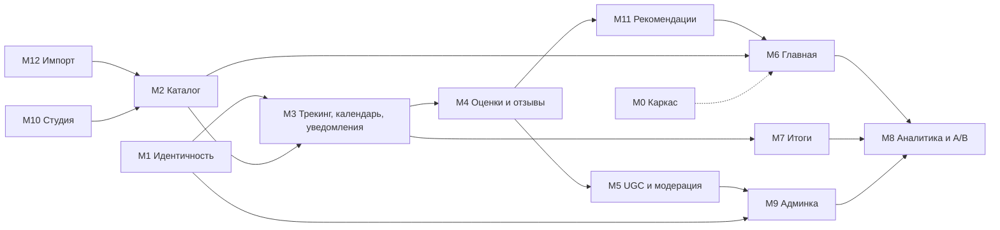

# MODULES — брифы модулей и реестр бизнес-операций

> v0.1 · черновик Фазы 2 · закрывает «бриф на страницу» из плана. Метки: **[РЕШЕНО]** · **[ГИПОТЕЗА]**. Глубокие спеки по шаблону `F-xx` — Фаза 4. Сущности `E-` уточняются в Фазе 5.

## Зависимости

## M0 Каркас (оболочка) · P0, заставка P1
- **Цель:** единая оболочка, навигация, темы, языки, состояния загрузки и ошибок.
- **Состав:** компоненты UI-01…UI-13 (`SCREENS`), страницы ошибок, футер, «О данных».
- **Правила:** ширина контента не меняется при развороте rail; разворот по наведению, фокусу и нажатию; тема и язык без вспышки при загрузке; пункты меню берутся из M2–M5; CLS = 0; `prefers-reduced-motion`.
- **Сущности:** настройки интерфейса (тема, язык) — в M1.
- **Риски:** стоимость стекла (бюджет blur-слоёв); мега-меню жанров на touch; заставка против SEO, LCP и мерцания (WCAG 2.3.1) — решения в `PLAN` А4.

## M1 Идентичность и роли · P0
- **Цель:** вход, права, безопасность аккаунта.
- **Состав:** регистрация по шагам (данные → подтверждение email → выбор 3–5 любимых), вход, выход, сброс пароля, сессии (список, отзыв), 2FA для служебных ролей, профиль и настройки (язык, тема, часовой пояс, приватность, уведомления, рекомендации вкл/выкл), мьют и бан, удаление аккаунта (14 дней на отмену → анонимизация **[ГИПОТЕЗА]**), экспорт данных.
- **Сущности:** E-User, E-Role, E-Session, E-EmailVerification, E-PasswordReset, E-TwoFactor, E-Preferences, E-Restriction (мьют / бан).
- **Операции:** OP-16.
- **Edge cases:** перечисление аккаунтов (одинаковый ответ на «email занят» и «письма нет»), перебор паролей, письмо не доходит — **на защите без интернета письма видны во встроенном «почтовом ящике разработчика»**, неподтверждённый аккаунт удаляется через 7 дней **[ГИПОТЕЗА]**, бан посреди сессии.
- **Вопросы:** внешний вход (Google, Яндекс) — P2.

## M2 Каталог (публичная часть) · P0
- **Цель:** найти сериал и всё о нём.
- **Состав:** сериал, сезон, серия, жанры, подборки (ручные и по правилам), персоны, поиск (названия ru / en / оригинал, люди, подборки, подсказки, исправление раскладки), фильтры с ползунками, «похожие», SEO (schema.org, hreflang).
- **Правила:** виден только опубликованный; при смене адреса 301; описание непросмотренной серии скрыто (H-16); рейтинги нормализуются к 10-балльной шкале.
- **Сущности:** E-Series, E-Season, E-Episode, E-Genre, E-Country, E-Network, E-Person, E-SeriesPerson, E-Collection, E-CollectionRule, E-Keyword, E-RatingPlatform, E-ExternalRating, E-Translation, E-Image, E-ImageVariant.
- **Операции:** OP-18.
- **Риски:** поиск по русской морфологии, скорость фильтров на 1000+ карточках.

## M3 Трекинг, календарь, уведомления · P0
- **Цель:** помнить, где я остановился, и не пропустить выход.
- **Состав:** статусы просмотра, отметка серий (одна / сезон / «до этой серии»), прогресс и «следующая серия», закладки, календарь (месяц / неделя / список, «все» и «мои»), правая панель «Предстоящие», подписка на сериал (автоматически при «Смотрю» и «В планах», можно отключить **[ГИПОТЕЗА]**), центр уведомлений (число, точка), настройки, тихие часы; для сериалов «Ждём сезон» — подписка «сообщить, когда объявят дату» **[ГИПОТЕЗА H-26]**.
- **Правила дат:** «сегодня вышло» / «завтра» / «через N дней» при N < 4, иначе дата; множественные числа через i18n; хранение в UTC, показ в часовом поясе пользователя; у стриминга чаще только дата; выход = группа серий сезона с одной датой (сезон целиком — один выход и одно уведомление).
- **Сущности:** E-WatchStatus, E-WatchMark (точная / ретро), E-Release, E-Subscription, E-Notification, E-NotificationPreference.
- **Операции:** OP-08, OP-09, OP-10.
- **Edge cases:** сезон целиком, перенос, TBA, смена часового пояса и DST, массовая отметка (ретро), отметка не вышедшей серии запрещена, архивированный сериал, сериал в списках, но снят с публикации.
- **Доставка:** в приложении — P0, email — P1, push через PWA — P2 (H-10).

## M4 Оценки и отзывы · P0
- **Цель:** оценить и высказаться; видеть честный рейтинг.
- **Состав:** оценка 1–10 (сериал, серия), отзыв (оценка + текст + спойлер-метка + язык), один отзыв на пользователя и сериал, правка с повторной проверкой, группы (**длинные / короткие** по длине; **положительные 7–10 / смешанные 5–6 / отрицательные 1–4** по оценке автора **[ГИПОТЕЗА]**), сортировки, голос «полезно», жалоба, гистограмма оценок, рейтинг сайта.
- **Рейтинг сайта:** сглаженное среднее `(v·R + m·C)/(v+m)`, где `R` — среднее по сериалу, `v` — число оценок, `C` — среднее по сайту, `m` — порог; показывается при `v` ≥ N, иначе «мало оценок»; значения `m`, N — в настройках системы.
- **Антинакрутка:** оценить можно только после отметки просмотра; ограничения частоты; вес новых аккаунтов — решение Фазы 4.
- **Сущности:** E-Rating, E-Review (особый вид E-Material), E-HelpfulVote, E-SiteRatingCache.
- **Операции:** OP-03, OP-04.
- **Edge cases:** изменение оценки и пересчёт, удалённый автор, язык отзыва не совпадает с языком интерфейса, короткий отзыв со спойлером.

## M5 UGC и модерация · P0 ядро, P1 обсуждения и руководства
- **Цель:** живое обсуждение без спойлеров, спама и недопустимого.
- **Виды материалов:** отзыв, комментарий, руководство, тема и пост обсуждения — **один общий конвейер** (E-Material с видом).
- **Конвейер:** отправка → нормализация текста → поиск по словарю RU+EN (без ML) → «опубликован» или «помечен». Автору сразу показано: «предположительно содержит недопустимый контент»; можно поправить и пройти проверку снова (не чаще раза в 5 минут) или ждать редактора. Опубликованный материал при правке остаётся в прежней версии, пока новая не пройдёт проверку **[ГИПОТЕЗА]**.
- **Очередь редактора:** материал за материалом, две кнопки «Одобрить» / «Запретить» (DEC-012), причина срабатывания, кластеры дублей (одно решение на кластер), горячие клавиши, отмена последнего решения в пределах окна **[ГИПОТЕЗА]**, сводное уведомление об очереди.
- **Антиспам:** лимиты по пользователю, IP и устройству; бюджет помеченных попыток → авто-мьют; доверие по возрасту аккаунта; потолок очереди; CAPTCHA или proof-of-work после порога; идея и 9 шагов — `PLAN` А1.
- **Прочее:** жалобы, словарь и белый список (редактор), мьют, аудит решений, прозрачность (причина и статус всегда видны автору).
- **Сущности:** E-Material, E-MaterialVersion, E-ModerationCheck, E-ModerationItem, E-Cluster, E-Report, E-DictionaryTerm, E-Whitelist, E-Restriction, E-RateCounter.
- **Операции:** OP-01, OP-02.
- **Риски:** ложные срабатывания («проблема Scunthorpe»), обход гомоглифами, флуд, нагрузка проверки.
- **Обсуждения как в Steam (P1):** раздел сериала, темы, закрепление и закрытие редактором, пагинация, сортировки.

## M6 Главная · P0 базово, баннеры и рекомендации P1
- **Цель:** за секунды показать, что нового и что смотреть.
- **Состав (сверху вниз):** три баннера дня → «Для вас» / «Популярное» → новинки 3×6 по кругу → бегущая строка подборок → жанры по 6 сериалов; справа «Предстоящие».
- **Баннеры (OP-05):** (1) «Новинка» — лучший по рейтингу среди сериалов с серией, вышедшей сегодня; (2) «Классика» — старше 10 лет и рейтинг ≥ 8,5; (3) «Выбор редакции» — назначает админ. На каждом: название, причина показа, рейтинг IMDb. Обновляются раз в сутки; запасные правила — `CONTENT-PLAN`.
- **Правила:** бегущая строка останавливается при наведении и фокусе, при `prefers-reduced-motion` статична; жанры — «случайные» с суточным зерном (стабильно в течение дня, важно для SEO и CLS); нет данных — блок перестраивается, а не показывает дыру.
- **Edge cases:** сегодня нет новых серий; < 18 новинок; пустая подборка; нет фона для баннера; JS отключён.

## M7 Итоги (Wrapped) · P1
- **Цель:** красиво показать личную историю просмотра.
- **Состав:** период «год» / «всё время»; слайды-истории: часы и серии, любимые жанры, топ сериалов, самый длинный марафон, серия дней подряд, любимое время суток (**только точные отметки**), «вы и сайт» (расхождение оценок), распределение оценок, страны и десятилетия; шеринг картинкой; по умолчанию приватно.
- **Правила:** порог данных (≥ N отметок); часы = число серий × длительность (где её нет — оценка по сериалу с пометкой); расчёт заранее, кэш.
- **Сущности:** E-RecapCache. **Операции:** OP-12.
- **Edge cases:** мало данных, ретро-отметки, смена года, часовой пояс, `prefers-reduced-motion`, клавиатура.

## M8 Аналитика и A/B · P1
- **Цель:** аналитик видит «всю подноготную» и проверяет гипотезы.
- **События:** таксономия `EV-xx` из измерения 16 всех модулей; анонимный идентификатор → склейка с пользователем при входе; согласие на cookies; фильтрация ботов.
- **Дашборды:** обзор (активные, регистрации, ключевые числа крупно), удержание и воронки, контент и поиск (поиск без результата, CTR баннеров и рекомендаций), качество модерации, скорость (RUM), пути.
- **A/B:** гипотеза, метрика, варианты, доля трафика, длительность; назначение по хэшу (стабильно); проверка SRM; тесты значимости (z для долей, Уэлча для средних); оценка размера выборки; остановка аналитиком, аварийная остановка админом; журнал.
- **Данные:** синтетическое население с пометкой «демо-данные» (H-02); аналитик видит только псевдонимизированные идентификаторы.
- **Операции:** OP-13, OP-15.
- **Edge cases:** малая выборка, «подглядывание» за результатом, пересечение экспериментов, блокировщики, смена варианта у вошедшего пользователя.

## M9 Администрирование · P0 пользователи и бэкап, P1 система
- **Цель:** управлять пользователями и следить за здоровьем системы.
- **Состав:** пользователи (множество фильтров: дата регистрации, роль, статус, язык, активность, число оценок), статистика пользователей, **средний и пиковый онлайн**, карточка пользователя (роль, бан, мьют, удаление с повторным паролем), системный обзор (запросы, p95, ошибки, задержка цикла событий, пул БД, очереди, задачи, место на диске, статус бэкапа), аудит (только чтение), резервные копии (расписание, ручной запуск, проверка восстановления), настройки системы.
- **Онлайн:** «в сети» = активность за последние N минут (heartbeat); хранится минутный ряд и агрегаты **[ГИПОТЕЗА]**.
- **Сущности:** E-AuditLog, E-OnlineSample, E-SystemSetting, E-BackupRun.
- **Операции:** OP-14, OP-16, OP-17.
- **Edge cases:** последний админ, удаление пользователя с материалами, массовый бан, экспорт больших выборок.

## M10 Контент-студия · P0 минимум, P1 остальное
- **Цель:** закрыть пробелы данных и вести кураторские части.
- **P0:** список неполных карточек и сомнительных пар, правка карточки (происхождение поля, блокировка от импорта), изображения и фокальная точка, массовое задание графика серий, **подборки вручную**, архивирование и история; начальное наполнение справочников (сид).
- **P1:** подборки по правилам, «выбор редакции» на календаре, кадры заставки, редактор справочников (жанры RU/EN, платформы рейтингов, страны), массовые операции, режим «по одному».
- **Подробно:** `CONTENT-PLAN` §7. **Операции:** OP-07.

## M11 Рекомендации · P1
- **Цель:** показать зрителю, что посмотреть, и объяснить почему.
- **Алгоритм (H-04, `PLAN` А5):** профиль вкуса по признакам просмотренного и оценённого; скоринг = сходство × качество + бонус новизны; item-based после порога пользователей; разнообразие; объяснение к каждой карточке.
- **Места:** «Для вас» на главной (вошедшим), «Похожие» на странице сериала, «Что дальше» после завершения; для гостя — «Популярное».
- **Управление:** «не интересно», выключение персонализации в настройках.
- **Холодный старт:** выбор 3–5 любимых при регистрации.
- **Сущности:** E-TasteProfile, E-RecommendationFeedback. **Операции:** OP-11.
- **Риски:** однообразие на малом каталоге; проверка качества на синтетических данных ограничена.

## M12 Импорт данных (IMDb + TMDB) · P0
- **Цель:** автоматически собрать и поддерживать каталог из 1000 популярных + новинок.
- **Состав и правила:** стадии, карта «поле → источник», сопоставление, отбор, лимиты, расписание, отчёты, снимок для защиты — `DATA-SOURCES`.
- **Сущности:** E-ImportRun, E-ImportItemResult, E-FieldProvenance.
- **Операции:** OP-06, OP-07.

## Реестр бизнес-операций (Бланк, п. 3.3.2: не менее 10 сверх CRUD)

| ID | Операция | Модуль | Приоритет |
|---|---|---|---|
| OP-01 | Проверка материала модерацией: нормализация, поиск по словарю, решение | M5 | P0 |
| OP-02 | Антиспам: бюджеты, кластеризация дублей, приоритизация очереди | M5 | P0 |
| OP-03 | Расчёт рейтинга сайта (сглаженное среднее, порог показа) | M4 | P0 |
| OP-04 | Классификация отзыва по группам (длина × оценка) | M4 | P0 |
| OP-05 | Генерация трёх баннеров дня с запасными правилами и ротацией | M6 | P1 |
| OP-06 | Импорт и сопоставление каталога IMDb ↔ TMDB | M12 | P0 |
| OP-07 | Расчёт полноты карточки и причин неполноты | M12·M10 | P0 |
| OP-08 | Расчёт календаря и подписей «сегодня / завтра / через N дней» с часовым поясом | M3 | P0 |
| OP-09 | Рассылка уведомлений о выходе серий (дедупликация, тихие часы) | M3 | P0 |
| OP-10 | Расчёт прогресса просмотра и «следующей серии» | M3 | P0 |
| OP-11 | Персональные рекомендации | M11 | P1 |
| OP-12 | Формирование итогов | M7 | P1 |
| OP-13 | Назначение в эксперимент A/B и расчёт значимости | M8 | P1 |
| OP-14 | Учёт онлайна, средний и пиковый | M9 | P1 |
| OP-15 | Агрегация аналитики | M8 | P1 |
| OP-16 | Анонимизация и удаление пользователя | M1·M9 | P0 |
| OP-17 | Резервное копирование и проверка восстановления | M9 | P0 |
| OP-18 | Подборки по правилам | M2 | P1 |

Итого 18; из них P0 — 11. Даже без P1 порог Бланка выполняется.
