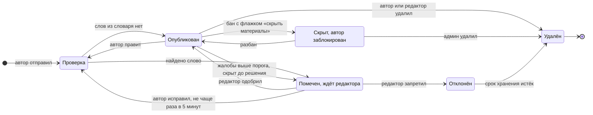
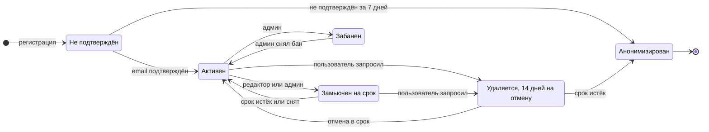
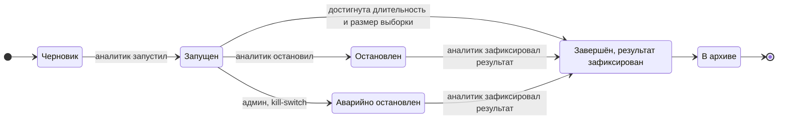

# STATES — конечные автоматы сущностей

> v0.2 · Фаза 2, обновлён в Фазе 4. Цель: найти недостижимые и тупиковые состояния и зафиксировать, кто имеет право на каждый переход. Метки: **[ГИПОТЕЗА]** — принято по умолчанию, автор поправит. Эти диаграммы идут в UML-раздел ПЗ (диаграммы состояний).
> **Известное расхождение:** таблица §1 разрешает удаление материала из любого состояния, но на диаграмме нет переходов `Checking → Удалён` и `Flagged → Удалён`. Автор удаляет материал, пока он на проверке, — путь не определён. Правку вносим при написании M5.

## 1. Пользовательский материал (отзыв, комментарий, руководство, тема, пост)

| Переход | Кто | Условие |
|---|---|---|
| отправка → Проверка | Автор | Не замьючен; соблюдены лимиты частоты |
| Проверка → Помечен | Система | Автору сразу: «предположительно содержит недопустимый контент» |
| Помечен → Проверка | Автор | Не чаще раза в 5 минут (spec); счётчик попыток входит в антиспам-бюджет |
| Помечен → Опубликован / Отклонён | Редактор, админ | Решение пишется в аудит; автор получает уведомление с причиной |
| Опубликован → Проверка | Автор | Прежняя версия остаётся видимой, пока новая не пройдёт **[ГИПОТЕЗА]** |
| Опубликован → Помечен | Система | Число жалоб ≥ порога (в настройках системы) |
| → Удалён | Автор, редактор, админ | Автор удаляет своё; чужое — редактор / админ |
| Опубликован → Скрыт | Админ | Бан с флажком «скрыть материалы» (DEC-020); при разбане возвращается в «Опубликован»; удалить скрытый может только админ |

**Особые случаи:** кластер идентичных помеченных материалов получает одно решение на всех; материал замьюченного автора, уже находящийся в очереди, остаётся в очереди; при удалении аккаунта автор анонимизируется, материал сохраняется.

## 2. Аккаунт

Сроки 14 и 7 дней — **[ГИПОТЕЗА]**. Забаненный не может сам запустить удаление (иначе обход бана); окончательное удаление — только админ с повторным паролем (OP-16). Смена состояния отзывает активные сессии.

## 3. Эксперимент A/B

Правила: после запуска варианты, доли трафика и метрика неизменны (иначе результат нельзя трактовать); пересекающиеся эксперименты на один элемент интерфейса запрещены; зафиксированный результат не редактируется.

## 4. Прочие сущности

| Сущность | Состояния | Переходы (кто) | Особые правила |
|---|---|---|---|
| Сериал (публикация) | Импортирован → Опубликован → В архиве | Импорт создаёт «Импортирован»; публикует система при минимуме полноты или админ; архивирует админ | Архив скрывает с главной и из поиска; ссылки в списках остаются как «снят с публикации»; возврат из архива — админ |
| Состояние выхода сериала (производное: логически вычисляется из дат выходов и статуса; физически может кэшироваться) | Анонс → Выходит → Ждём сезон → Завершён / Отменён | Система пересчитывает после каждого импорта и ежедневно | «Выходит» — есть выход в окне от −14 дней и дальше; «Ждём сезон» — статус Returning без дат; календарь и «Новинка дня» работают только по «Выходит». Источник истины — даты выходов |
| Выход (серия или группа серий сезона с одной датой) | Анонс (TBA) → Запланирован (дата) → Вышел; Запланирован → Перенесён → Запланирован; → Отменён | Импорт или админ; «Вышел» ставит система по дате | Перенос и отмена порождают уведомление подписчикам; TBA не показываем как дату; сезон целиком = один выход |
| Уведомление | Создано → Показано → Прочитано; Создано → Удалено | Система создаёт; пользователь читает и удаляет | Дедупликация (одна серия — одно уведомление); тихие часы откладывают доставку, не создание |
| Письмо (email, P1) | В очереди → Отправлено → Ошибка (повтор) → Отказ | Система | Повторы с растущей задержкой; предел попыток; журнал |
| Кластер модерации | Открыт → Решён → Закрыт | Редактор решает для всех материалов кластера | Новые идентичные материалы присоединяются к открытому кластеру; к решённому — получают то же решение автоматически **[ГИПОТЕЗА]** |
| Запуск импорта | Запланирован → Идёт → Успех / Частично / Ошибка; Частично, Ошибка → Возобновлён | Планировщик или админ | Не более одного запуска одновременно; после ошибки — возобновление с контрольной точки |
| Резервная копия | Запланирована → Идёт → Готова → Проверена; Идёт → Ошибка | Планировщик или админ | «Проверена» — только после пробного восстановления |
| Отметка просмотра | Нет → Отмечена (точная / ретро) → Снята | Зритель | Серия, не вышедшая по графику, отметить нельзя; снятие отметки пересчитывает прогресс и итоги |
| Статус просмотра | Нет → Смотрю / В планах / Просмотрено / Брошено / Отложено | Зритель; «Просмотрено» ставится автоматически, когда отмечены все вышедшие серии и сериал завершён **[ГИПОТЕЗА]** | Смена статуса меняет подписку (автоподписка при «Смотрю» и «В планах») |
