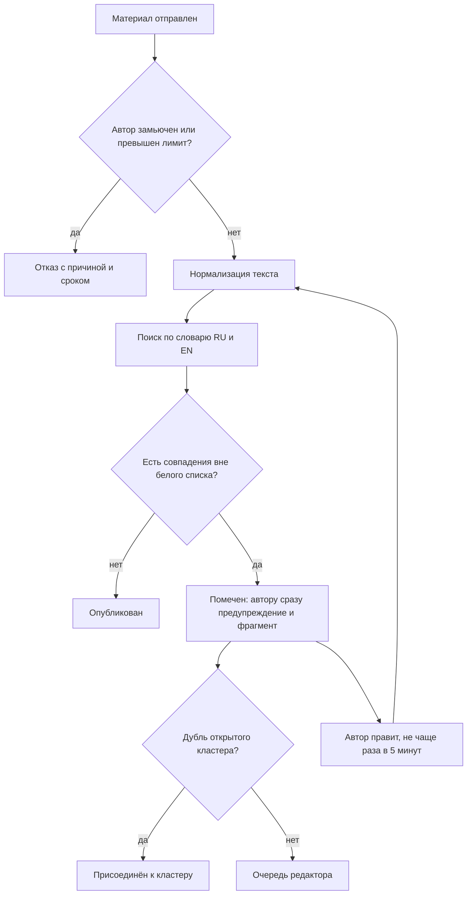

# MODERATION — требования к проверке материалов и антиспаму

> v0.1 · Фаза 3 · модуль M5, операции OP-01 и OP-02, кандидат на «схему алгоритма» для КП. Правила `R-MOD-NN`. Без ML: проверка — поиск по словарю на русском и английском. Словарь хранится как **данные** (не в документах и не в коде). Все числа — стартовые и настраиваемые в системных настройках **[ГИПОТЕЗА, H-24]**.

## 1. Конвейер проверки (OP-01)

## 2. Правила

### Проверка текста
| ID | Правило |
|---|---|
| R-MOD-01 | **Один конвейер** для отзывов, комментариев, руководств, тем и постов; поля (заголовок, тело) проверяются раздельно. |
| R-MOD-02 | **Нормализация обязательна и воспроизводима**, шаги по порядку: Unicode NFKC → нижний регистр → удаление невидимых символов (нулевая ширина, мягкий перенос, управляющие направлением) → единые пробелы → замена гомоглифов (латиница ↔ кириллица: a/а, e/е, o/о, p/р, c/с, x/х и т. п.; слово с двумя письменностями приводится к преобладающей) → замена цифр и символов внутри слов (0→о, 3→з/e, @→а и т. п.) → схлопывание повторов букв (варианты до 1 и до 2) → удаление разделителей между буквами слова («п.р.и.м.е.р», «п р и м е р») → `ё → е`. |
| R-MOD-03 | Поиск — автомат Ахо — Корасик по нормализованной строке (время линейно по длине текста); регулярные выражения из пользовательских данных и словаря **не** компилируются (`R-SEC-19`). |
| R-MOD-04 | Для коротких термов (< 4 знаков) обязательны границы слова; для остальных — совпадение по основе (русская и английская морфология: Snowball-стемминг токенов). Белый список (слова и фразы) отменяет совпадение внутри него: защита от «проблемы Scunthorpe». |
| R-MOD-05 | Любой текст проверяется **обоими** словарями (RU и EN); язык не определяем. |
| R-MOD-06 | Результат — список совпадений: идентификатор терма, категория, **позиции в исходном тексте** (через карту смещений нормализации). Это основа подсветки. |
| R-MOD-07 | Строгие термы (сразу «помечен») и мягкие (помечают при ≥ 2 совпадениях или вместе со ссылкой/контактом). Категории: недопустимая лексика, оскорбления и ненависть, угрозы, 18+, реклама и ссылки, контакты. |

### Антиспам (OP-02)
| ID | Правило |
|---|---|
| R-MOD-08 | **Бюджет помеченных попыток** на пользователя: 5 в час → автоматический мьют на 1 час; повтор — 24 часа; третий раз — флаг админу. |
| R-MOD-09 | Повторная проверка после правки — **не чаще раза в 5 минут** на материал (из spec); попытки входят в бюджет. |
| R-MOD-10 | Лимиты публикаций: зритель — 10 материалов в час; аккаунт младше 24 часов — 3 в час; по IP и устройству — отдельные потолки. |
| R-MOD-11 | **Потолок очереди** 2000 ожидающих. При переполнении новые помеченные материалы от аккаунтов низкого доверия в очередь не ставятся: автору «слишком много обращений, попробуйте позже» (429), в хранилище остаётся только хэш для кластеров. |
| R-MOD-12 | Автору показываем **фрагмент его текста** и категорию, но не слово из словаря; защита от «оракула» — интервал 5 минут, бюджеты, лимиты. |
| R-MOD-13 | **Кластеры дублей:** хэш нормализованного текста для точных и порог близости (SimHash) для почти одинаковых; редактор принимает одно решение на кластер; новые идентичные материалы присоединяются к открытому кластеру, к решённому — получают то же решение **[ГИПОТЕЗА]**. |
| R-MOD-14 | **Доверие** по возрасту аккаунта и истории решений: влияет на лимиты и приоритет очереди (кластер крупнее и автор доверенный — выше). |
| R-MOD-15 | После порога (2 помеченных за 10 минут) — proof-of-work или невидимая проверка; картиночных CAPTCHA нет (`R-A11Y-10`). |
| R-MOD-16 | Жалобы: порог (по умолчанию 3 разных пользователя) скрывает материал до решения редактора. |

### Работа редактора
| ID | Правило |
|---|---|
| R-MOD-17 | Интерфейс: **одна карточка за раз, две кнопки «Одобрить» / «Запретить»**, причина срабатывания и подсветка, кластер, горячие клавиши, отмена последнего решения в течение 10 секунд **[ГИПОТЕЗА]**; «Одобрить» предлагает добавить слово в белый список. |
| R-MOD-18 | Каждое решение и каждое изменение словаря — в журнал аудита (только добавление). |
| R-MOD-19 | Прозрачность: автор всегда видит статус материала и причину; о решении приходит уведомление. |
| R-MOD-20 | Редактор может добавить спойлер-метку материалу (без запрета). |
| R-MOD-21 | Правка опубликованного: прежняя версия видна, пока новая не прошла проверку. |
| R-MOD-22 | Уведомление редактору о очереди — сводкой («в очереди 214 → 3 кластера»), не по каждому материалу. |

## 3. Лимиты и пороги (стартовые, настраиваются)

| Параметр | Значение |
|---|---|
| Длина | отзыв 20–5000 знаков; комментарий 1–1000; пост 1–5000; руководство 500–30 000; заголовок 3–120; ник 3–24 |
| Группы отзывов по длине (для M4) | короткий < 300 знаков, длинный ≥ 1000 (подтверждено автором, DEC-015) |
| Группы по оценке автора (для M4) | отрицательные 1–4, смешанные 5–6, положительные 7–10 (подтверждено автором, DEC-015) |
| Интервал повторной проверки | 5 минут |
| Бюджет помеченных попыток | 5 в час |
| Мьют по бюджету | 1 час → 24 часа → флаг админу |
| Потолок очереди | 2000 |
| Порог жалоб | 3 разных пользователя |
| Окно отмены решения | 10 секунд |

## 4. Целевые показатели **[ГИПОТЕЗА]**

| Показатель | Цель |
|---|---|
| Время проверки текста 10 000 знаков, p95 | ≤ 5 мс на одном ядре (замер в Фазе 7) |
| Ложные срабатывания на чистом корпусе | ≤ 1% |
| Пропуски на корпусе обфускаций | ≤ 10% |
| Нагрузка L-02 (`PERFORMANCE`) | очередь не выше потолка, p95 отправки ≤ 500 мс |
| Медиана времени в очереди | цель задаёт аналитик на дашборде S-63 |

## 5. Тестовые корпуса

1. **Чистый** — обычные отзывы и обсуждения на RU и EN, в том числе с «опасными» подстроками (проблема Scunthorpe) и именами актёров.
2. **Обфускации** — гомоглифы, цифры вместо букв, повторы, разделители, невидимые символы, смешение письменностей.
3. **Спам** — ссылки, контакты, повторы одного текста, почти-дубли.
4. **Нагрузка** — длинные тексты, много повторов, тексты на границе лимитов.
5. **Позиции** — подсветка совпадает с исходным текстом после нормализации.

Тексты корпусов с реальной лексикой хранятся как данные теста, а не в документации.

## 6. Для КП

Схема алгоритма (лист 5.2 Бланка): блок-схема выше, развёрнутая шагами R-MOD-02…07. Диаграмма состояний материала — `STATES` §1. Последовательность «автор → проверка → очередь → решение → уведомление» — диаграмма последовательностей.

## 7. Чек-лист

Один конвейер для вида материала? (01) · Нормализация и карта смещений? (02, 06) · Белый список и границы слов? (04) · Бюджеты, интервал, потолок очереди? (08, 09, 11) · Кластеры и приоритет? (13, 14) · Карточка с двумя кнопками и отменой? (17) · Аудит и уведомление автору? (18, 19)
