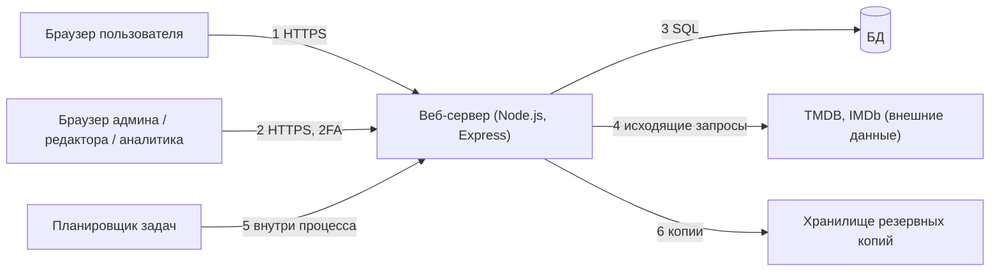

# THREAT-MODEL — модель угроз (STRIDE по границам доверия)

> v0.1 · Фаза 3. Реестр угроз `T-NN`; меры — правила `R-SEC` из `SECURITY`, `R-MOD` из `MODERATION`. Угроза считается закрытой, когда у неё есть тест (`TESTING`). Остаточный риск оцениваем: низкий / средний / высокий.

## Границы доверия

Границы: 1 — недоверенный клиент; 2 — привилегированный клиент; 3 — приложение ↔ БД; 4 — внешние данные недоверенные; 5 — внутренние задачи; 6 — резервные копии. STRIDE: **S** подмена, **T** искажение, **R** отказ от авторства, **I** раскрытие, **D** отказ в обслуживании, **E** повышение прав.

## Реестр угроз

| ID | Гр. | STRIDE | Угроза | Модуль | Меры | Остаток |
|---|---|---|---|---|---|---|
| T-01 | 1 | S | Подбор паролей, повторное использование утёкших | M1 | R-SEC-01, 05, 31 | средний |
| T-02 | 1 | S | Перечисление аккаунтов через регистрацию и сброс | M1 | R-SEC-06 | низкий |
| T-03 | 1 | S | Кража сессии (XSS, сеть) | все | R-SEC-02, 14, 20, 21 | низкий |
| T-04 | 2 | S | Фишинг админа, перехват 2FA | M9 | R-SEC-03, 04, 12 | средний |
| T-05 | 1 | T | Хранимый XSS через отзыв, руководство, тему, ник | M4, M5, M1 | R-SEC-14, 21 | низкий |
| T-06 | 4 | T | XSS через названия и описания TMDB/IMDb | M2, M12 | R-SEC-15 | низкий |
| T-07 | 1 | T | SQL-инъекция в фильтрах, поиске, сортировках | M2 | R-SEC-16 | низкий |
| T-08 | 1 | T | CSRF на изменяющих действиях (статус, оценка, бан) | все | R-SEC-23, 02 | низкий |
| T-09 | 1 | T | Подмена параметров: роль в теле запроса, массовое присвоение | M1, M9 | R-SEC-09, 11 | низкий |
| T-10 | 1 | T | Отравление аналитики поддельными событиями | M8 | `ANALYTICS` R-AN-12, R-SEC-31 | средний |
| T-11 | 1 | T | Накрутка рейтинга, review bombing | M4 | оценивать после отметки просмотра, лимиты, вес новых аккаунтов (M4) | средний |
| T-12 | 1 | T | Подмена варианта A/B на клиенте | M8 | назначение на сервере, `ANALYTICS` R-AN-15 | низкий |
| T-13 | 2 | R | Админ отрицает удаление или бан | M9 | R-SEC-36 | низкий |
| T-14 | 2 | R | Редактор отрицает решение модерации | M5 | R-SEC-36, R-MOD-18 | низкий |
| T-15 | 1 | R | «Я этого не писал» | M5 | версии материалов, журнал | низкий |
| T-16 | 1 | I | IDOR: чужие уведомления, закладки, черновики | M3, M5 | R-SEC-10 | низкий |
| T-17 | 1, 2 | I | Утечка персональных данных через экспорт, аналитику, логи | M8, M9 | R-SEC-27, 29; аналитик без PII | средний |
| T-18 | 1 | I | Раскрытие стека, конфигурации, `.env`, копий | ops | R-SEC-40, 41; тест файлов | низкий |
| T-19 | 1 | I | Спойлеры в сниппетах поиска и ответах API | M2 | `SEO` R-SEO-14; серверная выдача скрытых описаний | средний |
| T-20 | 1 | I | Оракул словаря: перебор для выяснения запрещённых слов | M5 | R-MOD-12, 5-минутный интервал, бюджеты | средний |
| T-21 | 1 | D | Флуд запрещённым контентом переполняет очередь | M5 | R-MOD-08…13 | средний |
| T-22 | 1 | D | Массовая регистрация спам-аккаунтов | M1 | R-SEC-31, 34; подтверждение email | средний |
| T-23 | 1 | D | Исчерпание соединений потоков реального времени | M3, M9 | R-SEC-32 | низкий |
| T-24 | 1 | D | Тяжёлые запросы (фильтры, поиск) | M2 | R-SEC-31, 32; бюджет запросов (`PERFORMANCE`) | низкий |
| T-25 | 1 | D | Алгоритмическая атака на проверку текста (ReDoS, огромные тексты) | M5 | R-SEC-19, 13; лимиты длины | низкий |
| T-26 | 4 | D | Исчерпание лимитов TMDB, зацикливание импорта | M12 | `PRODUCTION-READINESS`: повторы с задержкой; один запуск за раз | низкий |
| T-27 | 2 | E | Повышение прав через пропуск проверки в админ-маршруте | M9 | R-SEC-09, 35; тест матрицы | низкий |
| T-28 | 2 | E | Обход повторного пароля и 2FA | M9 | R-SEC-04, 12 | средний |
| T-29 | 4 | E | SSRF через загрузчик изображений | M12, M10 | R-SEC-18 | низкий |
| T-30 | 1 | T | Открытое перенаправление после входа | M1 | R-SEC-08 | низкий |
| T-31 | все | T | Вредоносный или уязвимый пакет | все | R-SEC-38 | средний |
| T-32 | все | I | Секреты в git, ключ TMDB | ops | R-SEC-39 | низкий |
| T-33 | 4, 2 | T | Вредоносное изображение (полиглот) | M10, M12 | R-SEC-17 | низкий |
| T-34 | 6 | I | Кража резервной копии | M9 | R-SEC-30 | низкий |
| T-35 | 2 | T | Ошибочное массовое действие админа (бан, удаление) | M9 | подтверждение с числом затронутых, аудит, откат транзакцией | средний |

## Что остаётся после мер

Средние остатки (T-01, 04, 10, 11, 17, 19, 20, 21, 22, 28, 31, 35) — кандидаты на отдельные тесты и мониторинг. Принятые допущения: один процесс сервера; один регион; админ — доверенный человек с 2FA; внешние данные недоверенные, но источник не подменяется злоумышленником (HTTPS к TMDB).
