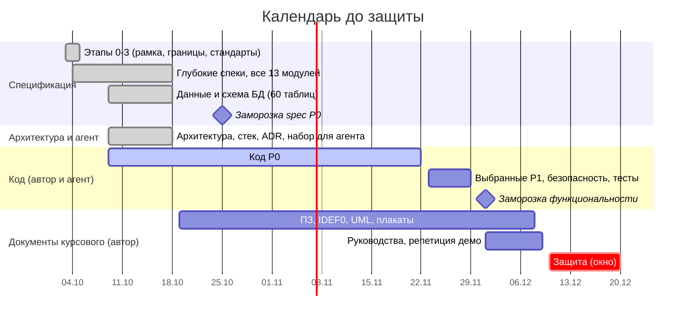

# STATUS — где мы сейчас (одна страница)

> Обновлено **2026-10-21**. Генерируется скриптом `tools/docs-build/build_registries.py` — вручную не правим. **Начинайте чтение с этого файла.**

## 1. Коротко

- **Проект:** сервис оценки и отслеживания сериалов с календарём выхода серий (курсовой, Node.js + Express). До защиты **50–60 дня** (окно 10–20 декабря).
- **Разделение труда:** планирование (спеки, модель данных, архитектура и стек, набор для агента) ведётся здесь; код и документы курсового — автор и агент, код P0 идёт с 9 октября. Набор для агента — §6.
- **Спеки всех 13 модулей написаны, идёт код P0.** Готовы M0, M1, M2 (F-02-01…11), M3 (F-03-01…10), M4 (F-04-01…09), M5 (F-05-01…05, 08, 09), M6 (F-06-01…06), M9 (F-09-01…07), M10 (F-10-01…10) и M12 (F-12-01…10). Служебные страницы (F-00-05: «О проекте и данных», правила сообщества, «Конфиденциальность и cookies», страницы ошибок) сделаны 21.10.  в M5 — бюджет помеченных с авто-мьютом (R-MOD-08) и потолок очереди (R-MOD-11), в F-05-03; в M3 — F-03-11 (скрытие описаний непросмотренных серий, P1) и F-03-12 (подписка ICS, P2). «Похожие» (F-02-08) сделаны 21.10: веса сходства с поправкой на редкость признака лежат в таблице, считаются после импорта, на странице сериала — шесть постер-карточек. Слой подробной карточки постера (F-02-07, UI-10) построен 21.10: данные по намерению, кэш на пять минут, на touch — нижняя панель. Экран «Импорт» (S-76, F-12-08) с кнопками запуска построен 21.10: полный прогон стал задачей планировщика (кнопка заводит строку, планировщик её выполняет), сухой прогон отличается флагом `dry_run` и в каталог не пишет. Загрузка изображения в студии (F-10-04) сделана 21.10 без новых зависимостей: multipart разбирает стандартная библиотека Node. Схема студии приведена к решениям автора от 21.10 (поля материалов, названия подборок на двух языках, версии карточки, время правки, признаки «сырой жанр» и «изменён вручную», таблица заданий). Состояние кода по операциям — `TRACEABILITY` §1.
- **График:** этапы 5, 7 и 8 закрыты раньше плана — данные и схема БД (60 таблиц), архитектура и стек, набор для агента готовы; код P0 идёт второй неделей, заморозка spec P0 — 25 октября.
- **Отклонений от задания нет.** Все три отклонения согласованы: английский интерфейс — письменно (DEC-026), одна таблица стилей и Redis — устно 12.10 (DEC-031). **Риск** — ревью спек: решения подтверждены, но ни одна из 106 фич не проверена автором.
## 2. Прогресс

| Что | Готово | Шкала |
|---|---|---|
| Этапы 0–3: рамка, границы, широкий проход (модули, экраны, пути, состояния), сквозные стандарты | 4 из 4 (черновики, ждут вашего ревью) | ██████████ 100% |
| Данные: спайк IMDb + TMDB (прогоны 1 и 2) | ✔ выполнен, итоги — `DATA-SOURCES` §10 | ██████████ 100% |
| **Этап 4 — глубокие спеки, все 13 модулей** | **13 из 13**: M0, M1, M2, M3, M4, M5, M6, M7, M8, M9, M10, M11, M12 | ██████████ 100% |
| — из них нужные для защиты (P0, 10 модулей) | **10 из 10** | ██████████ 100% |
| Этап 5 — данные и ER-диаграмма | данные и схема готовы (`DOMAIN-MODEL`, `DATABASE` — 60 таблиц, `db/schema.sql`); ER-диаграмма — на авторе | ████████░░ 80% |
| Этап 6 — проверка и заморозка spec v1.0 | реестры, `COVERAGE`, `EDGE-CASES`, `TRACEABILITY` собраны; заморозка — 25 октября | ███████░░░ 70% |
| Этап 7 — архитектура и стек | готово: `ARCHITECTURE`, `STACK`, ADR | ██████████ 100% |
| Этап 8 — AGENTS для opencode | готово: `AGENTS`, карта чтения, протоколы, команды, пакеты контекста | ██████████ 100% |
| Код и документы курсового (ПЗ, IDEF0, UML, плакаты, руководства) | **на автора и агента**; от планирования — только спецификация | — |
_Проценты по модулям считают модули равными; это ориентир, а не трудозатраты._

**Очередь спецификаций пуста:** написаны все 13 модулей. Очередь кода ведётся по бизнес-операциям, а не по модулям, — см. `TRACEABILITY` §1.

## 3. Календарь

**Факт на 2026-10-21:** спеки 13 из 13, данные и схема БД, архитектура и стек, набор для агента — готовы; код P0 идёт с 9 октября, десять операций из семнадцати с кодом и тестами (`TRACEABILITY` §1); заморозка spec P0 — 25 октября по плану.

## 4. Что нужно от вас

**А. Решения: подтверждены автором 2026-10-06 (DEC-020).** Список ниже — для справки; новых вопросов нет.

| № | Решение | Где подробно |
|---|---|---|
| 1 | «Ждём сезон»: календарь, правая панель и «Новинка дня» работают только по сериалам в состоянии «Выходит» | H-27 |
| 2 | Каталог = топ-1000 по голосам IMDb + до ≈ 300 сериалов, у которых есть серии до 31.12 | H-20 |
| 3 | Подборки на главной: в P0 создаёт вручную админ, порядок по весу; по правилам и по просмотрам — P1 | H-31 |
| 4 | Регистрация в 3 шага; письмо подтверждается кнопкой; вход только по email; после подтверждения сразу вход | H-50, H-56, H-57 |
| 5 | «Любимые» при регистрации идут только в рекомендации, не в «просмотрено» | H-55 |
| 6 | Удаление аккаунта: 14 дней на отмену; оценки и материалы остаются без имени | H-61 |
| 7 | Приватность по умолчанию закрыта: статистика и закладки в профиле выключены | M1 F-01-06 |
| 8 | Описания серий по умолчанию показываются; скрытие от спойлеров — настройка пользователя | H-37 |
| 9 | Правая панель «Предстоящие» — только на списковых страницах, от 1280 px | H-30 |
| 10 | «Похожие» в P0 — простой алгоритм по жанрам, ключевым словам, людям | H-44 |
| 11 | На защите письма идут в «почтовый ящик разработчика» внутри сайта (экран S-84) | H-51 |
| 12 | Ник проверяется словарём модерации; поиск ищет сериалы, людей и подборки, но не пользователей | H-54, H-12 |
| 13 | Материалы забаненного: оставлять или скрывать (флажок «скрыть материалы» в диалоге бана) | Q-18 |

**Б. Библиотеки:** берём только реально нужное и оптимальное (DEC-021). Список с обоснованием — `STACK` §3 (зависимости) и §4 (отказы). Сейчас вопросов нет.

**В. По желанию:** пришлите `catalog-snapshot.json` из `tools/data-spike/spike-out/` — по нему проверю правило «сначала даты, потом статус» (Q-19) и уточню очередь неполных. Не блокирует.

## 5. Готовность к защите

Прогресс спецификации **не равен** готовности к защите. Предъявляемые артефакты курсового считаются отдельно:

| Артефакт | Требование | Состояние |
|---|---|---|
| IDEF0-модель процессов | Бланк 5.1, чертёж А4 | **нет ни одной диаграммы** |
| Схема алгоритма бизнес-логики | Бланк 5.2, чертёж А4 | **нет**; кандидат назван в `MODERATION` §6 |
| Плакат: UML-диаграмма классов | Бланк 5.3.1 | **нет**; блокер снят — классы выводятся из `DATABASE` (60 таблиц) |
| Плакат: модели представления | Бланк 5.3.2 | **нет**; блокера нет — `JOURNEYS`, `SCREENS`, `STATES` готовы |
| Плакат: скриншоты окон | Бланк 5.3.3 | **нет**; блокер снят по работающим экранам M0–M4 |
| Пояснительная записка | Бланк §4 | **нет**; разделы 4.1.3 и 4.2.6 закрыты, остальные 15 — нет |
| Руководство по установке | Бланк 3.3.3 | **нет** |
| Руководство пользователя | Бланк 3.3.3 | **нет**; ролей 5, значит требуется 5 руководств |
| Листинг алгоритмов и скрипта генерации БД | Бланк, приложения | **нет**; DDL готов (`DATABASE` §2), листинг кода — из `src/services/*` |
| Отчёт «Антиплагиат» | Бланк, приложения | **нет** |

Подробная карта «требование → документ → чего не хватает» — `07-kp/COMPLIANCE-BLANK.md`.

## 6. Карта документов: что читать, что нет

| Группа | Файлы | Вам нужно |
|---|---|---|
| **Читать** | этот файл `STATUS.md`; `README.md` в корне репозитория | да, целиком |
| **Проверять по мере готовности** | `01-product/features/M*.md` — по модулям | не целиком: смотрите «Назначение», «Сценарий», «Приёмка», «UI»; спорное вынесено в §4 |
| **Справочники** (на них ссылаются спеки) | `01-product`: MODULES, SCREENS, JOURNEYS, STATES · `02-design/PRINCIPLES` · `03-standards/*` (10 стандартов) · `04-data`: DATA-SOURCES, CONTENT-PLAN | нет; открывайте, когда спека отсылает |
| **Журналы** | `00-process/ROADMAP.md` (что и в каком порядке делается, границы зон ответственности), `00-process/DECISIONS.md` (решения и гипотезы), `00-process/PLAN.md` (процесс и календарь) | ROADMAP — да; остальные по желанию |
| **Собираются скриптом** | `01-product/FEATURES.md`, `00-process/COVERAGE.md`, `00-process/EDGE-CASES.md`, этот `STATUS.md` | не открывать; правки вносятся в спеки модулей |
| **Инструменты** | `tools/data-spike/` (замер данных, отчёты двух прогонов), `tools/docs-build/` (`build_registries.py` — реестры и этот файл; `context-pack.mjs` — пакеты контекста) | `build_registries.py` запускается после правок спек; `context-pack.mjs` — при работе над фичей |
| **Исходники автора** | `input/` — задание, ТЗ, референсы, чек-листы | по мере надобности; перечень в `input/README.md` |

## 7. Цифры (считаются автоматически)

- Файлов документации: **63**; решений автора: **70**; гипотез: **70**; правил в стандартах: **213**.
- Описано фич: **106** (из них P0 — 82); экранов в каталоге: **60** (+2 снятых, идентификаторы не переиспользуются); граничных случаев: **230**.
- Проверка ссылок между документами: все ссылки на `EC-`, `H-`, `R-` имеют определение.
