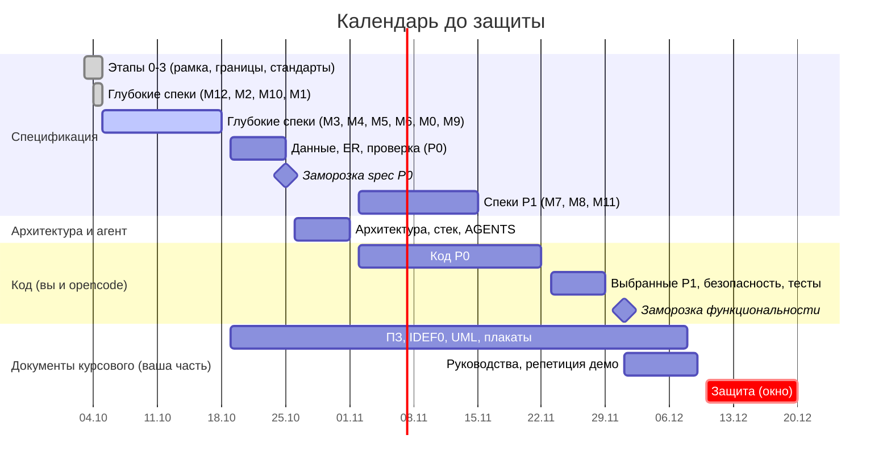

# STATUS — где мы сейчас (одна страница)

> Обновлено **2026-10-05**. Генерируется скриптом `tools/docs-build/build_registries.py` — вручную не правим. **Начинайте чтение с этого файла.**

## 1. Коротко

- **Проект:** сервис оценки и отслеживания сериалов с календарём выхода серий (курсовой, Node.js + Express). До защиты **66–76 дней** (окно 10–20 декабря).
- **Моя часть — довести планирование:** спеки, ER, архитектура и стек, AGENTS и набор для opencode (§5). Код и документы курсового ведёте вы с opencode, старт кода ≈ 2 ноября.
- **Мы на этапе 4 из 8 — пишем подробные спецификации.** Заморозка spec P0 ≈ 25 октября.
- **Опережаем график примерно на 1,5 недели** (оценка): этапы 0–3 и четыре модуля этапа 4 закончены раньше плана.
- **Риск №1** — ревью спек: 13 решений вы подтвердили; дальше смотрите спеки по мере готовности (§5) и присылайте правки, пока код не начат.
## 2. Прогресс

| Что | Готово | Шкала |
|---|---|---|
| Этапы 0–3: рамка, границы, широкий проход (модули, экраны, пути, состояния), сквозные стандарты | 4 из 4 (черновики, ждут вашего ревью) | ██████████ 100% |
| Данные: спайк IMDb + TMDB (прогоны 1 и 2) | ✔ выполнен, итоги — `DATA-SOURCES` §10 | ██████████ 100% |
| **Этап 4 — глубокие спеки, все 13 модулей** | **6 из 13**: M1, M2, M3, M4, M10, M12 | █████░░░░░ 46% |
| — из них нужные для защиты (P0, 10 модулей) | **6 из 10** | ██████░░░░ 60% |
| Этап 5 — данные и ER-диаграмма | не начато | ░░░░░░░░░░ 0% |
| Этап 6 — проверка и заморозка spec v1.0 | не начато | ░░░░░░░░░░ 0% |
| Этап 7 — архитектура и стек | не начато | ░░░░░░░░░░ 0% |
| Этап 8 — AGENTS для opencode | не начато | ░░░░░░░░░░ 0% |
| Набор для opencode (AGENTS, карта чтения, протоколы, команды, пакеты контекста) | **1 из 5 частей** (генератор пакетов); остальное — этап 8 | ██░░░░░░░░ 20% |
| Код и документы курсового (ПЗ, схемы, плакаты, руководства) | **на вас и opencode**; от меня — только планирование | — |
_Проценты по модулям считают модули равными; это ориентир, а не трудозатраты._

**Дальше в очереди (P0):** M0 — каркас оболочки; M5 — UGC и модерация (ядро); M6 — главная; M9 — админка (пользователи, бэкап). **Потом (P1):** M7 — итоги; M8 — аналитика и A/B; M11 — рекомендации.

## 3. Календарь

## 4. Что нужно от вас

**А. Решения: подтверждены автором 2026-10-06 (DEC-020).** Список ниже — для справки; новых вопросов нет.

| № | Решение | Где подробно |
|---|---|---|
| 1 | «Ждём сезон»: календарь, правая панель и «Новинка дня» работают только по сериалам в состоянии «Выходит» | H-27 |
| 2 | Каталог = топ-1000 по голосам IMDb + до ≈ 300 сериалов, у которых есть серии до 31.12 | H-20 |
| 3 | Подборки на главной: в P0 создаёт вручную админ, порядок по весу; по правилам и по просмотрам — P1 | H-31 |
| 4 | Регистрация в 3 шага; письмо подтверждается кнопкой; вход только по email; после подтверждения сразу вход | H-50, H-56, H-57 |
| 5 | «Любимые» при регистрации идут только в рекомендации, не в «просмотрено» | H-55 |
| 6 | Удаление аккаунта: 14 дней на отмену; оценки и материалы остаются без имени | H-61 |
| 7 | Приватность по умолчанию закрыта: статистика и закладки в профиле выключены | M1 F-01-06 |
| 8 | Описания серий по умолчанию показываются; скрытие от спойлеров — настройка пользователя | H-37 |
| 9 | Правая панель «Предстоящие» — только на списковых страницах, от 1280 px | H-30 |
| 10 | «Похожие» в P0 — простой алгоритм по жанрам, ключевым словам, людям | H-44 |
| 11 | На защите письма идут в «почтовый ящик разработчика» внутри сайта (экран S-84) | H-51 |
| 12 | Ник проверяется словарём модерации; поиск ищет сериалы, людей и подборки, но не пользователей | H-54, H-12 |
| 13 | Материалы забаненного: оставлять или скрывать (флажок «скрыть материалы» в диалоге бана) | Q-18 |

**Б. Библиотеки:** берём только реально нужное и оптимальное (DEC-021). Список с обоснованием по каждой появится в Фазе 7, письмо руководителю — по этому списку. Сейчас вопросов нет.

**В. По желанию:** пришлите `spike2-out/catalog-snapshot.json` (лежит рядом с `report2.md`) — по нему проверю правило «сначала даты, потом статус» (Q-19) и уточню очередь неполных. Не блокирует.

## 5. Карта документов: что читать, что нет

| Группа | Файлы | Вам нужно |
|---|---|---|
| **Читать** | этот файл `STATUS.md`; `01-product/VISION.md` | да, целиком |
| **Проверять по мере готовности** | `01-product/features/M*.md` — по модулям | не целиком: смотрите «Назначение», «Сценарий», «Приёмка», «UI»; спорное уже вынесено в §4 |
| **Справочники** (на них ссылаются спеки) | `01-product`: MODULES, SCREENS, JOURNEYS, STATES, ROLES-PERMISSIONS · `02-design/PRINCIPLES` · `03-standards/*` (10 стандартов) · `04-data`: DATA-SOURCES, CONTENT-PLAN · `00-process/GLOSSARY` · `07-kp/COMPLIANCE-BLANK` | нет; открывайте, когда спека отсылает |
| **Журналы** | `00-process/DECISIONS.md` (решения и гипотезы), `00-process/PLAN.md` (процесс и календарь) | по желанию |
| **Собираются скриптом** | `01-product/FEATURES.md`, `00-process/COVERAGE.md`, `00-process/EDGE-CASES.md`, этот `STATUS.md` | не открывать |
| **Инструменты** | `tools/data-spike/` (замер данных), `tools/docs-build/` (`build_registries.py` — реестры и этот файл; `context-pack.mjs` — пакеты контекста, запускает opencode) | запускаете только спайк |

## 6. Цифры (считаются автоматически)

- Файлов документации: **34**; решений автора: **21**; гипотез: **70**; правил в стандартах: **210**.
- Описано фич: **65** (из них P0 — 57); экранов в каталоге: **60**; граничных случаев: **146**.
- Проверка ссылок между документами: все ссылки на `EC-`, `H-`, `R-` имеют определение.
